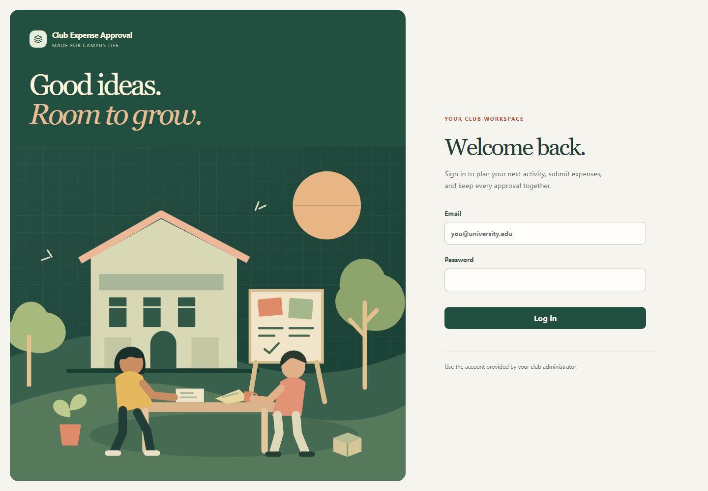
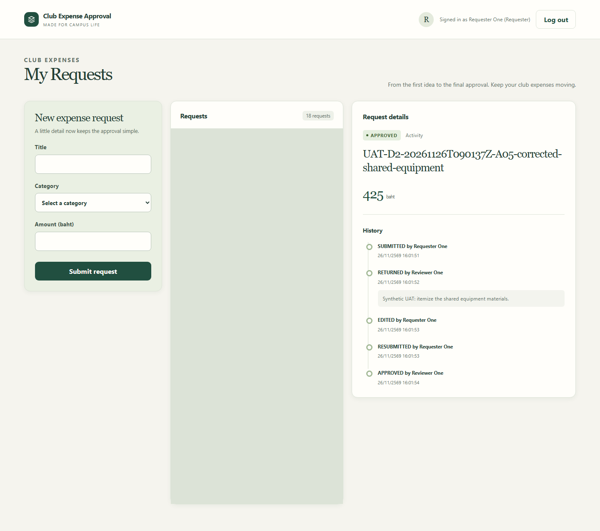
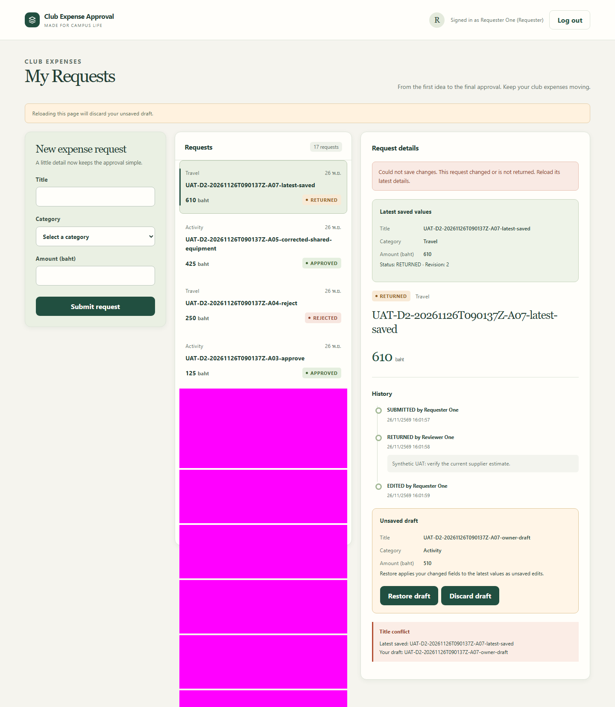
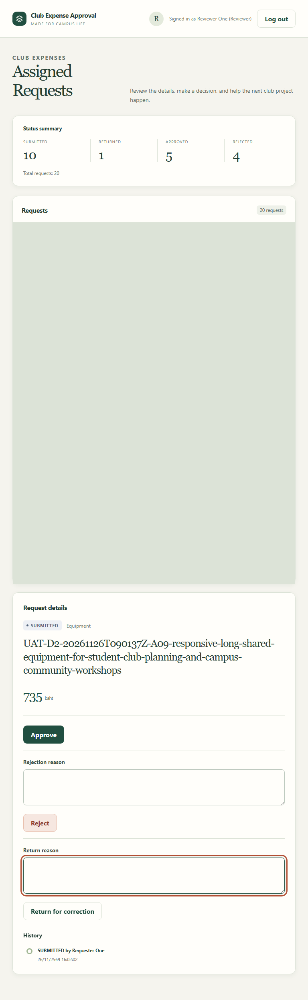
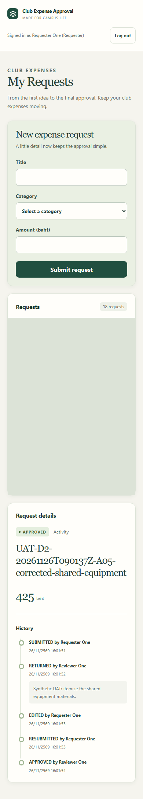

# Club Expense Approval — Project Deliverable 2

**Report source packet — 26 November 2026 (Asia/Bangkok)**

CPE334 · TH-038 · Theme5 · author chaproi · student ID67070507215. Solo instructor-approved status is recorded in the original baseline. **Full student name and student-authored reflection/contribution text must be supplied by the student.** No AI-written personal reflection or final acceptance statement is substituted.

Repository: https://github.com/chaproi/club-expense-approval

Reviewed/deployed main: **cc6b04c8e98191be591a3b755d25988148523909**

Live app: https://s981b09c9-4d7hbszvwq-as.a.run.app

Documentation preparation branch: docs/d2-postdeploy-2026-11-26. This packet is documentation, not a new application release. It does not claim final PDF submission.

## Reading this packet

The assessed areas are **A (5), B (25), C (15), D (10), E (15)** with their real rubric titles below. Values are weights, not awarded marks. The original baseline also has sections A–E; those are historical source organization only.

The entire required baseline/SRS/inventory/System SDS/traceability and five feature contracts are embedded in the appendices, not replaced by links. Selected screenshots are local packet assets. Linked raw machine logs provide drill-through while the report includes the actual outcomes, failure history, limitations, code excerpts, review chains and setup steps.

{{RUBRIC}}

# A. Sprint 1 continuity and change status (5)

The original Sprint1 delivered F-01 authentication, F-02 request submission/owned list/detail/history, and F-03 assigned approve/reject. Corrected baseline main **43aa8d7472aa8852654d0d634d7239c3765c5869** remains identifiable. Sprint2 elaborates already-planned RETURNED editing and round revisions; it does not reopen terminal or submitted records for arbitrary edits. Existing Requester/Reviewer/Origin guards and history are retained.

The original external Lab6 team TH-033_P3 (cottonlnwza and thananun-7203) reported18 scripted passes, two exploratory failures and two Low observations. Both Medium defects were fixed/tested/reviewed in PR32 and released in PR33. On22Nov21:18–21:19 Bangkok they independently retested exact43aa8d7/revision00007-9wq and recorded **Accepted with explicitly documented minor limitations**. The original failed rows and archive digests remain preserved in the embedded Lab6 status appendix. This is historical, version-specific independent evidence.

**Deliverable2 has no mandatory new external peer acceptance gate.** On26Nov the owner directed automated checks against the new cc6b04c deployment. They are labelled accordingly and do not extend historical peer acceptance or record the owner's final D2 decision.

Continuity on released cc6b04c: exact-main CI47/47 unit/API and19/19 browser; live PD-A01/A03/A04/A06/A10 passed auth, approval/rejection, denials and owner readback. Fifteen existing accessible records remained exact during the postdeploy session. No suitable complete pre-release shared-data snapshot was available, so exact preservation across release is not claimed. The legacy Lab5 record remained readable and unmodified.

# B. Sprint 2 contracts and working increment (25)

F-04 returns an assigned SUBMITTED request with reason/current revision; its owner reads the persisted reason and atomic history. F-05 saves valid owner changes only from RETURNED, then explicitly resubmits the same ID. All successful writes increment revision and append the proper event atomically; rejected/stale writes preserve state.

F-05 v1.1 preserves attempted draft/base revision/changed fields on real stale Save409. Latest saved values remain separate. Restore applies only changed fields on top of latest values; Discard/read retry do not mutate. Users manually Save current revisions; repeated conflicts, denied access, account switches/reload and action-specific errors are covered. BF-01 removes phantom clean drafts and clears recovery after Resubmit.

{{COMPLETION}}

## Two substantive Issue/PR engineering chains

### Chain 1 — F-05 / Issue36 → defect42 / PR43

- Initial F-04/F-05/count contracts preceded code at c7539ee (reviewed PR39); API RED18795b7 preceded GREENfeea765 and reviewed PR40/41.
- Staging acceptance exposed draft loss on409 and a contract ambiguity. Issue42 isolated the defect from Issue36; contract v1.1 was committed **cda506993dbab0b15af1bd70c96265b69117ef6a** before recovery implementation.
- Lifecycle RED **1667ec2877ba926ad9ca902de50947c14037bf4a**:14 executed,1 passed,13 failed,0 skipped; setup/selection were valid and failed cases reached semantic assertions. Earlier A1–A3 and later unsuccessful G1/G2/G3 attempts remain recorded.
- GREEN **ffefb2da0c812f5dee17309cefcfd3e01b30313e**:47 API/17 browser plus build/Docker, without assertion changes.
- PR43 reviewer identified BF-01. New tests-only **95d7d2b6c41f8f3ef48e77ceeac69a02cd6f993b**:2/2 semantic failures. GREEN **cb05d627c0bb1cdaf76f636c17f3f2458c81b71f**:47/47 API,19/19 browser, build/Docker; exactly one RESUBMITTED event and no Restore/edit write.
- Corrected PR43 final head f487956 was independently approved by thananun-7203, merged at7ab4168, then included in reviewed release PR48/maincc6b04c. Our live PD-A07 genuinely received409 and verified Restore0 writes/manual current-revision Save.
- Source records: [Issue36](https://github.com/chaproi/club-expense-approval/issues/36), [Issue42](https://github.com/chaproi/club-expense-approval/issues/42), [PR43 approval](https://github.com/chaproi/club-expense-approval/pull/43#pullrequestreview-6059594795), [preserved BF-01 record](https://github.com/chaproi/club-expense-approval/blob/cc6b04c8e98191be591a3b755d25988148523909/docs/evidence/deliverable-2/f05-draft-recovery-bf01.md).

### Chain 2 — dependency Issue44 / PR45

- Assessment identified deepmerge-ts/effect advisories in Prisma6.19.3→@prisma/config6.19.3. Before audits had four High entries from two advisories and ancestors. The plan **45f7046f754cf3eda8adb7c1ab0b1f3d3174a396** preceded the package change.
- Candidate **a6c93abd350b9926cb51ff287339cd4d02ff2013** keeps Prisma/Client6.19.3 with scoped deepmerge-ts8.0.0/effect3.22.1 overrides. Only those resolved lock entries/metadata changed. Prisma7 was not silently adopted, and audit-fix-force was not used.
- Fresh install/generate/validate, full and omit=dev audits reported zero findings;47 API/19 browser, TypeScript/build/Docker passed. Actual image versions, migration/seed and authenticated HTTP smoke ran; --help was not substituted.
- Populated upgrade **43aa8d7→a6c93ab** created3 old requests/5 events under Sprint1, compared exact immediate migration snapshots except revision0 backfill, then performed intentional Return/Edit/Resubmit/Approve, checking original IDs/assignment/createdAt and old events. Final3 requests/9 events and terminal guards/restart reconstruction passed. This is an isolated rehearsal, not direct CloudSQL proof.
- Evidence head d385c23 was independently approved in PR45 and merged7175362. Reviewed integration #46, UI #47 and release #48 retained the same server/schema/dependency/migration inputs.
- [Issue44](https://github.com/chaproi/club-expense-approval/issues/44), [PR45 approval](https://github.com/chaproi/club-expense-approval/pull/45#pullrequestreview-6061894648), [candidate verification](https://github.com/chaproi/club-expense-approval/blob/cc6b04c8e98191be591a3b755d25988148523909/docs/evidence/deliverable-2/dependency-remediation/verification.md).
- The audit before/after is dependency-remediation evidence, **not browser RED**. deepmerge-ts8 exceeds the upstream exact pin; compatible config/Map behavior is not universally certified. Remove only after a reviewed upstream fix with dependency/audit/domain/browser/Docker/populated-upgrade checks.

## Two actual automated test excerpts

These are exact excerpts from the unchanged released test files, not invented pseudocode or tests written for this report. They were executed as part of exact-main47/19 CI; no suite was rerun in this documentation batch. Excerpts depend on the existing guarded fixture/auth helpers and are not standalone runnable files.

### Excerpt 1 — real API optimistic-concurrency and old-round rejection

Source: server/test/return-resubmit-summary.test.ts, released main cc6b04c. Real authenticated HTTP and PostgreSQL; two current-revision edits and resubmits must yield one200/one409 without duplicate events. Current-revision final approval succeeds while absent/old revisions remain409.

{{API_EXCERPT}}

### Excerpt 2 — BF-01 clean draft, no automatic writes and exact final event

Source: client/test/f05-draft-recovery.spec.ts, released main cc6b04c. Includes the real helper assertions used by the same-value Restore test: no draft/Discard/warning, no extra write, explicit current-revision Resubmit, original event prefix exact and one new RESUBMITTED event. Its source history includes the meaningful2-case RED and separate GREEN above.

{{BROWSER_EXCERPT}}

# C. Sprint 3 contracts and working progress (15)

F-06 **counts only** is working and released: all four current status bins/total derive from one assignedReviewerId-scoped groupBy, with explicit zeros, no unauthorized global totals and refresh after writes. API exact-scope/zero/restart assertions and the combined browser journey passed at released main. In live PD-A08, V1 independently matched its scoped list (9 submitted,1 returned,5 approved,4 rejected,total19) and V2 was all zero. Creating the final layout fixture intentionally changed V1 to10/1/5/4,total20, as shown in the screenshot.

**Not implemented/tested:** AC-F06-05/06 approved-category/final-stage totals, all8 F-07 two-stage ACs, and all5 F-08 filter ACs. Their full contracts/AC/STS are embedded. Existing main still uses one Reviewer per request and no status-filter product UI. Pending designs do not count as delivered behavior.

Dependencies: F-07 validates two distinct authorized Reviewers, preserves old terminal records/history and adds intermediate PENDING_FINAL_REVIEW; F-06 totals must exclude intermediate approvals, and F-08 must intersect status with authorization. Follow the dated plan in E; do not invent completion or instructor-approved Lab7 scope.

# D. Updated requirements and test traceability (10)

The complete current SRS retains **8 FR,10 BR and2 NFR identifiers**. Full feature inventory, System SDS and requirement→feature→AC→actual assertion mappings are embedded, plus all five complete feature contracts and the original Sprint1 baseline for F-01–F-03. Full tables distinguish normative requirements, executed source evidence, representative live cases and planned Final work.

The dedicated completion table maps16 Sprint2 ACs and4 count-checkpoint ACs to existing source assertions/result/release. Earlier source SHA/failed attempts remain unchanged. An AC's entire test matrix is not inferred from an unrelated suite total or a happy-path screenshot; live boundary/race/transport/restart permutations not repeated are explicitly qualified.

Source review is evidenced by PRs39/40/41/43/45/46/47 and release48, not an AI approval. No scenario or mark is promoted by this documentation batch. Historical pending text inside appendices is visibly labelled as a former checkpoint; current status summaries and this report govern today's delivery status without changing requirements.

# E. Integrated release candidate (15)

## Reviewed release, actual CI and deployment

| Evidence | Exact revision / observed result |
|---|---|
| Original local campus regression | 465ebea:47 API/19 browser PASS; source-specific historical evidence |
| Reviewer breakpoint correction | 3426915:build/four rendered widths PASS; initial761/768 overflow retained |
| PR47 CI | headc59b625, test merge76d06c3:47/19/build/Docker PASS |
| Release PR48 first CI | head1bce9c8, test mergec2df054:47/19/build/Docker PASS |
| Actual final release approval | thananun-7203 approved synchronized headecab746; [review](https://github.com/chaproi/club-expense-approval/pull/48#pullrequestreview-6070771204) |
| Merged main/deployment CI | **cc6b04c**; [run45786768391](https://github.com/chaproi/club-expense-approval/actions/runs/45786768391):47 API/19 browser, zero failed/skipped; build/Docker PASS |
| Required migration execution | s981b09c9-migrate-hbkpk succeeded26Nov08:56:19Z before service update |
| Deployed revision/traffic | s981b09c9-00008-pch, log-reported100% at08:56:35Z |
| Pushed immutable registry manifest digest | sha256:2afb158a393ded77dbacb0b29b1bc7559449ed2fa903537ff54165932b934995 |
| Actual live checks | **8 public +10 authenticated PASS**,26Nov08:57–09:03Z; owner-directed automation |

The SHA-tagged image asia-southeast1-docker.pkg.dev/cpe-se-course-2026/s981b09c9/s981b09c9:cc6b04c8e98191be591a3b755d25988148523909 was used for registry push, migration-job update and service deployment in the same successful workflow. The digest above is the **pushed manifest digest**. Direct revision-resolved imageDigest/current traffic/task-detail reads were unavailable: gcloud absent and signed-in Chrome inspection not approved. Do not call it an independently read runtime field.

No redeploy/restart or live database change occurred during report preparation. The earlier acceptance run intentionally retained5 synthetic requests/14 events, all listed in its record; all15 pre-existing accessible records were exact during that session. Without a suitable pre-release snapshot, release-wide shared-data equality is not established.

## Selected deployed demonstrations

These are real deployed captures from26Nov, not mockups or new screenshots taken for this report. Unrelated historical list contents were deliberately masked for privacy. Every selected image was previously visually inspected; copying it here does not relabel its capture time or source.

### Login composition and actual public root

Public root200; keyboard Email→Password→Log in/Shift+Tab and reduced motion passed. Anonymous me/list/summary401 and wrong-Origin login403 returned safe envelopes. Both service URLs reached the canonical app; no /health route was assumed.

### Owner Return/Edit/Resubmit/Approve history

CasePD-A05, request8c02cdde-64f2-4647-abbc-758d7d2f7542, rev4 APPROVED. Exact history SUBMITTED,RETURNED,EDITED,RESUBMITTED,APPROVED with original ID/createdAt and expected fields retained. Grey list mask is redaction, not empty data.

### Real stale-Save conflict and explicit recovery

PD-A07, request604b579d-93a7-4da2-91cc-6c53fe74f2ea. Actual backend409 from two owner sessions; latest Travel/610 and local draft are separate. Restore performed0 writes; explicit Save used current revision and preserved untouched latest fields. This capture is before Restore; finalrev3 RETURNED. Magenta historical-card masks are intentional redaction.

### Reviewer at768px and mobile owner readback

PD-A09: viewport/scrollWidth768, one grid column, long owned title, native Enter selection, Tab/Shift+Tab and reduced motion passed. No extra decision was made for that layout fixture.

PD-A10:390px scrollWidth390, complete five-event history and reload/readback. This is emulated Chromium viewport evidence, not physical-device or screen-reader certification.

## Setup, repeatability and operations

### Clean local setup

Use Node24, npm, PostgreSQL and Docker Desktop/Compose for the optional isolated stack. Clone main, record the actual SHA, and check out the reviewed release for reproducibility. Keep secret values private.

~~~powershell
git clone --branch main https://github.com/chaproi/club-expense-approval.git
cd club-expense-approval
git checkout --detach cc6b04c8e98191be591a3b755d25988148523909
npm.cmd ci
Copy-Item .env.example .env
# Privately set local DATABASE_URL, a separate TEST_DATABASE_URL,
# APP_ORIGIN, PORT, DEFAULT_REVIEWER_EMAIL and local SEED_DEMO_PASSWORD.
npm.cmd run db:migrate
npm.cmd run db:seed
npm.cmd run build
npm.cmd start
~~~

Seed only a new owned local/demo database, never shared CloudSQL. Match APP_ORIGIN exactly to the local URL/PORT. For development use the existing dev:api/dev:web commands in two terminals; for the production bundle use Express's npm start. Migration and seed commands remain available from the Docker image.

### Existing regression workflow (documented, not rerun here)

Verify the dedicated disposable test target before migration. Set DATABASE_URL/TEST_DATABASE_URL to that same isolated target, then run:

~~~powershell
npm.cmd run db:migrate
npm.cmd test
npm.cmd run build
npm.cmd exec -- playwright install chromium
npm.cmd run test:e2e
docker build -t club-expense-approval:local-check .
~~~

These commands describe repeatability. The actual results in the evidence table came from their recorded revisions/runs, not from this documentation batch.

For parallel Compose verification use a unique project name/image tag/free localhost port and ignored .env.compose; the full deployment guide remains available in the repository. PostgreSQL uses a separate named volume; migrate must complete before app startup. Never print compose config with secrets; config --quiet is the safe syntax check.

### Reviewed release/deployment operations

Feature/fix branches→staging/sprint-2→reviewed release PR→main. Main triggers reusable CI then WIF/demo deployment, SHA-tagged registry image, required migration job with --wait, then CloudRun service update. Preserve DATABASE_URL secret reference and portal-managed settings. The report does not authorize another deployment.

Known resource names: project cpe-se-course-2026, region asia-southeast1, service s981b09c9, migration job s981b09c9-migrate, CloudSQL s981b09c9-pg, ArtifactRegistry s981b09c9. Credentials are never embedded.

## Known limitations and factual status

- deepmerge-ts8 scoped override is outside Prisma's exact upstream pin; tested paths passed, universal configuration/Map compatibility is not certified. Keep reviewed removal/reverification criteria.
- Accepted historical Low observations: cross-tab session UI and UTF-16 title-length counting; not falsely marked fixed.
- No direct current revision imageDigest/traffic/task read, no complete pre-release shared-data snapshot, no new service restart in live checks.
- Chromium desktop/mobile emulation, sampled contrast and keyboard/reduced motion are not full WCAG, screen-reader, physical-device or cross-browser certification.
- Optional PR47 notes remain unimplemented/non-blocking: recovery controls could precede very long history; neutral pending wording would suit both roles.
- Original RED, setup/type/query failures and screenshot-mask correction retain their verdicts; documentation did not manufacture GREEN. First live harness attempt2pass/1selectionfailure/7unreached preceded the corrected10pass attempt, with no domain writes during that failed attempt.
- Original Lab6 independent evidence is preserved separately. No new external UAT is required for D2; separate Lab6 PDF/reciprocal archive availability is not certified by this packet.
- Owner final D2 acceptance and submission remain **not recorded**. Student text and final PDF QA are still required.

{{PLAN}}

## Student-authored material — deliberately not fabricated

**Full student name / cover confirmation:** TO BE SUPPLIED BY STUDENT.

**Personal reflection:** TO BE WRITTEN BY STUDENT. Explain one actual contract ambiguity, a concrete RED/GREEN lesson, tradeoffs/limitations and what you would change next. This prompt is a writing aid, not assessed prose.

**Contribution and AI-use statement:** TO BE CONFIRMED/WRITTEN BY STUDENT. Existing evidence shows chaproi directed/inspected AI-assisted requirements/code/tests/docs/deployment. Identify your own decisions, checks, effort and limitations in your own words. External source reviewers and historical UAT participants must receive accurate scope/version attribution; AI did not approve its own work or hear a screen reader.

**Owner final decision/date and submission receipt:** NOT RECORDED. Complete only after your review; do not sign or submit through this packet automatically.

# Full source appendices

The generator embeds complete text from each listed required document, including historical checkpoints. Current dated summaries supersede old Pending statements without rewriting historical executions. Historical baseline A–E are not the current rubric. Normative rules/IDs are unchanged; planned F-06/F-07/F-08 requirements remain planned.
