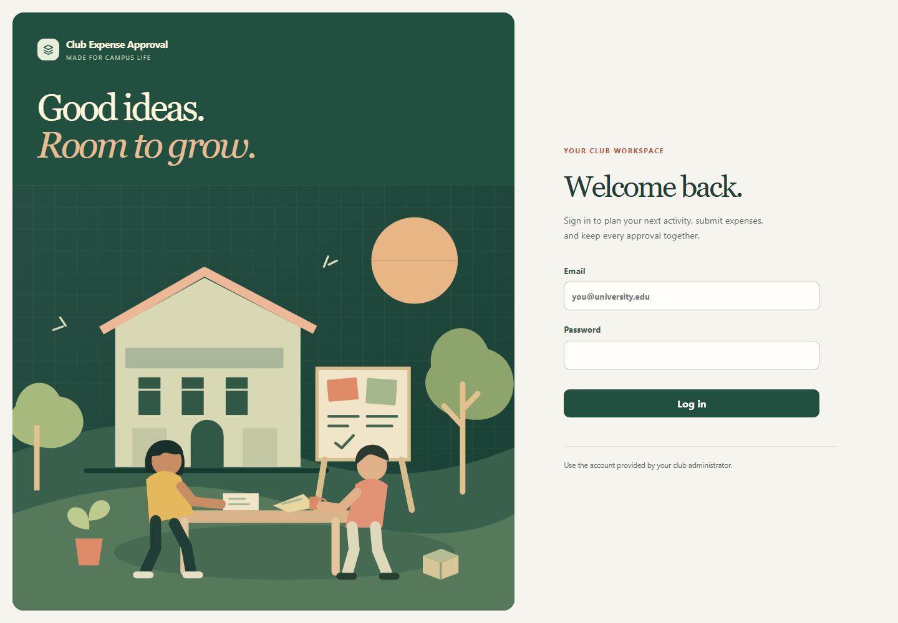
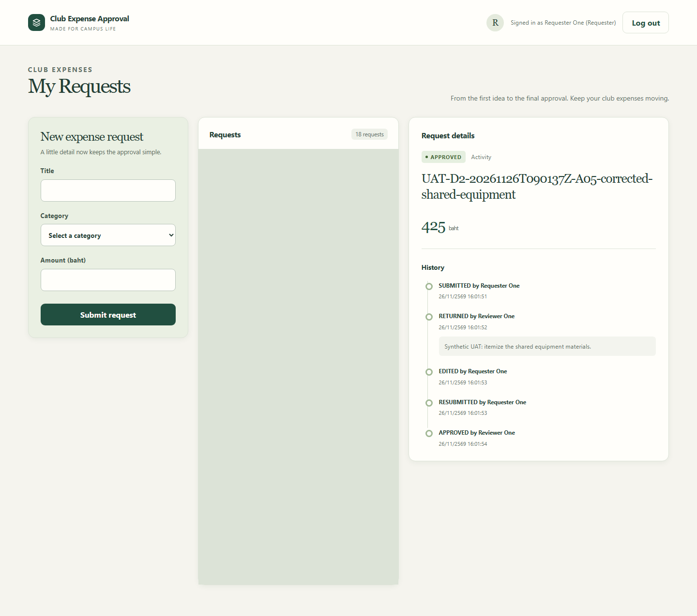
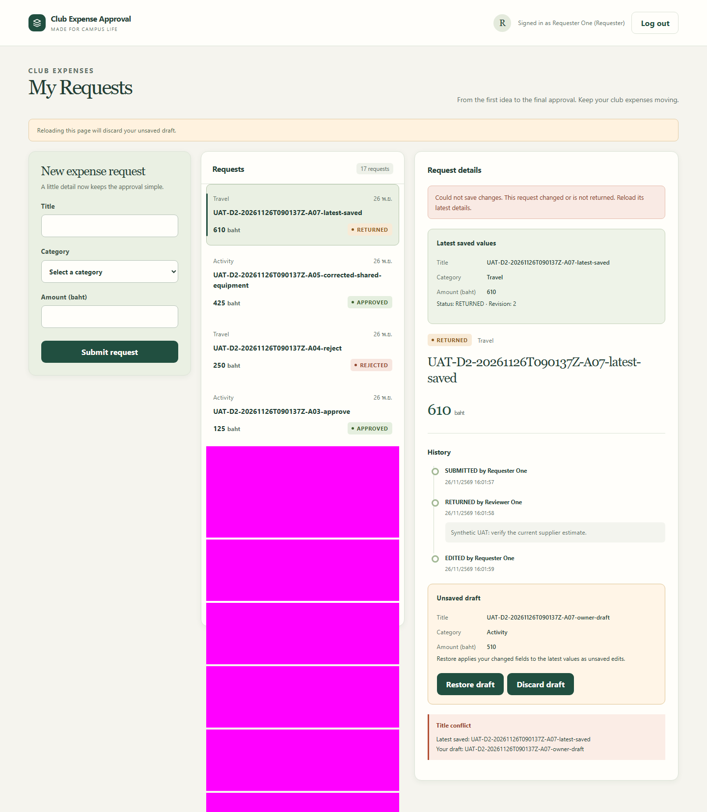
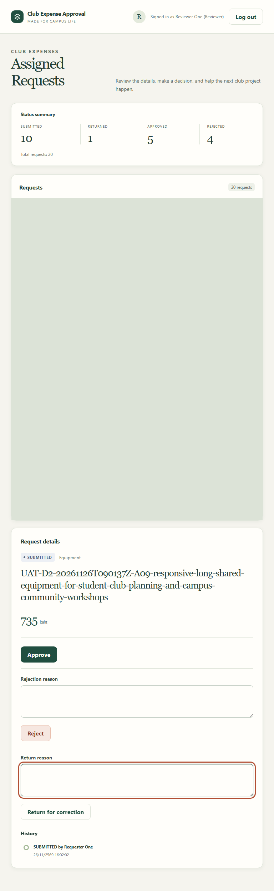
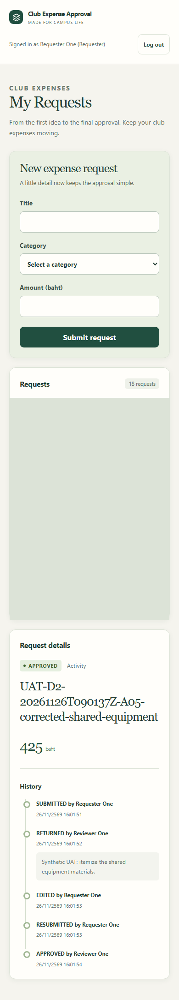

# Club Expense Approval — Project Deliverable 2

**Report source packet — 26 November 2026 (Asia/Bangkok)**

CPE334 · TH-038 · Theme5 · author chaproi · student ID67070507215. Solo instructor-approved status is recorded in the original baseline. **Full student name and student-authored reflection/contribution text must be supplied by the student.** No AI-written personal reflection or final acceptance statement is substituted.

Repository: https://github.com/chaproi/club-expense-approval

Reviewed/deployed main: **cc6b04c8e98191be591a3b755d25988148523909**

Live app: https://s981b09c9-4d7hbszvwq-as.a.run.app

Documentation preparation branch: docs/d2-postdeploy-2026-11-26. This packet is documentation, not a new application release. It does not claim final PDF submission.

## Reading this packet

The assessed areas are **A (5), B (25), C (15), D (10), E (15)** with their real rubric titles below. Values are weights, not awarded marks. The original baseline also has sections A–E; those are historical source organization only.

The entire required baseline/SRS/inventory/System SDS/traceability and five feature contracts are embedded in the appendices, not replaced by links. Selected screenshots are local packet assets. Linked raw machine logs provide drill-through while the report includes the actual outcomes, failure history, limitations, code excerpts, review chains and setup steps.

## Actual Project Deliverable 2 rubric

These are the supplied rubric areas/weights, not marks awarded. The historical baseline's A–E section labels are not substituted for them.

| Rubric area | Evidence now available | Remaining before final PDF/submission |
|---|---|---|
| A Sprint 1 continuity and change status (5) | Corrected baseline43aa8d7; incoming Lab 6 defects and independent retest/acceptance at that version preserved; inherited cases pass in exact-main CI; deployed PD-A01/A03/A04/A06/A10 cover current auth/decisions/denials/readback. | Include the original evidence distinctions and known Low limitations; private Lab 6 archives remain separate, not new D2 UAT. |
| B Sprint 2 contracts and working increment (25) | Full F-04/F-05 SDS/API/data/AC/STS, meaningful original RED→GREEN and BF-01 correction, independent reviews #40/#41/#43, all16 per-AC mappings below, released R and live PD-A05/A07 demonstration. | Student-authored reflection/contribution and final owner decision; do not manufacture RED for later verification. |
| C Sprint 3 contracts and working progress (15) | Full F-06/F-07/F-08 contracts included. F-06 count checkpoint AC01–04 working/released/CI-verified/live-scoped; approved totals, two-stage approval and filtering explicitly planned. | Present the dated Final plan; no claim that all Sprint3 is implemented. |
| D Updated requirements and test traceability (10) | Full SRS, inventory, System SDS, requirement matrix, per-AC implementation/test/result/version mapping, two real test excerpts and source hashes included in the report packet. | Final human read-through of the exported PDF and its links/tables. |
| E Integrated release candidate (15) | Reviewed chain #39→#40→#41→#43→#45→#46→#47, release #48 approved on ecab746 and merged R; exact-main CI 47/19, build/Docker; migration/deploy and owner-directed live18 checks. | Owner's final acceptance; retain direct-cloud and pre-release snapshot limitations; finish/export the report and submit only by owner action. |

Evidence: [deployment/live record](#appendix-postdeploy), [original independent Lab 6 status](#appendix-lab6), [report source packet](#packet-guide).

# A. Sprint 1 continuity and change status (5)

The original Sprint1 delivered F-01 authentication, F-02 request submission/owned list/detail/history, and F-03 assigned approve/reject. Corrected baseline main **43aa8d7472aa8852654d0d634d7239c3765c5869** remains identifiable. Sprint2 elaborates already-planned RETURNED editing and round revisions; it does not reopen terminal or submitted records for arbitrary edits. Existing Requester/Reviewer/Origin guards and history are retained.

The original external Lab6 team TH-033_P3 (cottonlnwza and thananun-7203) reported18 scripted passes, two exploratory failures and two Low observations. Both Medium defects were fixed/tested/reviewed in PR32 and released in PR33. On22Nov21:18–21:19 Bangkok they independently retested exact43aa8d7/revision00007-9wq and recorded **Accepted with explicitly documented minor limitations**. The original failed rows and archive digests remain preserved in the embedded Lab6 status appendix. This is historical, version-specific independent evidence.

**Deliverable2 has no mandatory new external peer acceptance gate.** On26Nov the owner directed automated checks against the new cc6b04c deployment. They are labelled accordingly and do not extend historical peer acceptance or record the owner's final D2 decision.

Continuity on released cc6b04c: exact-main CI47/47 unit/API and19/19 browser; live PD-A01/A03/A04/A06/A10 passed auth, approval/rejection, denials and owner readback. Fifteen existing accessible records remained exact during the postdeploy session. No suitable complete pre-release shared-data snapshot was available, so exact preservation across release is not claimed. The legacy Lab5 record remained readable and unmodified.

# B. Sprint 2 contracts and working increment (25)

F-04 returns an assigned SUBMITTED request with reason/current revision; its owner reads the persisted reason and atomic history. F-05 saves valid owner changes only from RETURNED, then explicitly resubmits the same ID. All successful writes increment revision and append the proper event atomically; rejected/stale writes preserve state.

F-05 v1.1 preserves attempted draft/base revision/changed fields on real stale Save409. Latest saved values remain separate. Restore applies only changed fields on top of latest values; Discard/read retry do not mutate. Users manually Save current revisions; repeated conflicts, denied access, account switches/reload and action-specific errors are covered. BF-01 removes phantom clean drafts and clears recovery after Resubmit.

## Per-feature technical completion

| Feature | Implementation and review | Actual verification and provenance | Released state |
|---|---|---|---|
| F-01/F-02/F-03 continuity | Inherited authentication/owned requests/assigned decision; Sprint1 fixes retained | Lab6 independent43aa8d7 acceptance; exact-main R CI; live PD-P03/P04 and PD-A01/A03/A04/A06/A10 | R deployed; owner final D2 decision separate |
| F-04 | Return/reason/revision/history; reviewed #40/#41 | API T-F04-01–05, combined browser; exact-main CI PASS; PD-A05/A06 live subset | R |
| F-05 | RETURNED-only save/resubmit; account/request-scoped recovery; BF-01; reviewed #40/#41/#43 | API T-F05-01–06;16 recovery/BF-01 browser cases plus3 inherited journeys; exact-main CI PASS; PD-A05/A07 live | R |
| F-06 counts only | Single assigned-scope DB groupBy; safe zero bins and refetch; reviewed #40/#41 | API T-F06-01/02/03 and combined browser; exact-main CI PASS; PD-A08 live list-vs-summary/UI counts and V2 zeros | R |
| F-06 totals | Approved-category totals/final-stage semantics specified | AC-F06-05/06 unimplemented/unexecuted | PLANNED, not delivered |
| F-07 | Fixed two-stage contract/design reviewed #39 | AC-F07-01–08 unimplemented/unexecuted | PLANNED |
| F-08 | Authorized status-filter contract/design reviewed #39 | AC-F08-01–05 unimplemented/unexecuted | PLANNED |
| Dependency remedy | Scoped @prisma/config6.19.3 overrides; reviewed #45 | candidate a6c93ab clean install/audits/image migration/HTTP/populated upgrade; unchanged relevant inputs at R; exact-main CI generation/Docker PASS | R, override caveat retained |
| Campus UI | Four presentation/artwork paths; reviewed #47, breakpoint fix3426915 | local465ebea47/19; focused3426915 four widths; exact-main R CI; live desktop/390px/Reviewer768/reduced-motion/keyboard | R |

## Sprint 2 per-AC completion (16 ACs)

Exact paths: **API** = server/test/return-resubmit-summary.test.ts; **Journey** = client/test/expense-decisions.spec.ts, named T-F04-05/T-F05-06/T-F06-04; **Recovery** = client/test/f05-draft-recovery.spec.ts. These are existing assertions inspected in source, not coverage inferred only from filenames or totals. API implementation is server/src/expense-requests.ts plus expense-input.ts; recovery implementation is client/src/expense-requests.tsx. Every R cell means full SHA cc6b04c8e98191be591a3b755d25988148523909.

| AC | Implemented behavior | Actual automated assertion/evidence | Current result and live subset | Released main |
|---|---|---|---|---|
| AC-F04-01 | Assigned Reviewer returns with trimmed reason; one atomic event and owner read | API T-F04-01 exact status/reason/history; Journey | CI PASS; PD-A05 returned reason/history PASS | R |
| AC-F04-02 | Validate reason/revision/shape without writes | API T-F04-02 empty/301/NUL/surrogate/type/extra-field unchanged snapshot | CI PASS; those full boundary permutations were not rerun live | R |
| AC-F04-03 | Authentication/role/assignment/self/Origin | API T-F04-03 exact denied snapshots; inherited self policy | CI PASS; PD-P03/P04/A06 live denial subset PASS, no new live self-review fixture | R |
| AC-F04-04 | Terminal/repeat/race/overflow cannot append a transition | API T-F04-04 concurrent200/409 and preserved events/int32 limit | CI PASS; PD-A06 stale/terminal subset PASS; real race/exhaustion remain CI evidence | R |
| AC-F04-05 | Durable return/history and old records | API restart T-F04-05/T-F05-06; Journey; populated upgrade a6c93ab | CI PASS; PD-A05/A10 deployed readback PASS; no new service restart or exact pre-release shared snapshot | R |
| AC-F05-01 | Owner saves valid fields from RETURNED, EDITED event | API T-F05-01/04 exact ID/fields/revision/events; Journey | CI PASS; PD-A05/A07 explicit manual Save PASS | R |
| AC-F05-02 | Boundary/forged edits preserve fields/history | API T-F05-02 invalid/forged shapes with exact snapshots | CI PASS; full boundary matrix not repeated live | R |
| AC-F05-03 | Owner/role/state/Origin and revision maximum | API T-F05-03 deny edit/resubmit; inherited T-04 SUBMITTED remains409 | CI PASS; PD-A06 wrong principal/terminal/Origin subset PASS | R |
| AC-F05-04 | Explicit Resubmit same request; retained assignment/old history | API T-F05-01/04; current-revision decision in T-F05-05; Journey | CI PASS; PD-A05 full five-event deployed sequence PASS | R |
| AC-F05-05 | Optimistic concurrency and old-round rejection | API T-F05-05 concurrent edits/resubmits and edit-vs-resubmit, exact200/409/events | CI PASS; PD-A06/A07 genuine stale responses PASS; concurrent race remains CI evidence | R |
| AC-F05-06 | Correction/resubmit state survives app/client reconstruction | API restart; Journey checks dirty-resubmit blocking and final DB state | CI PASS; PD-A05/A10 browser reload/readback PASS, not a new server restart | R |
| AC-F05-07 | Real409 retains separate attempted draft/latest and conflicts | Recovery T-F05-07 two owner sessions; exact saved DB state | CI PASS; PD-A07 real live409/latest/draft/title marker PASS | R |
| AC-F05-08 | Restore only changed fields; Discard/read controls no write; manual Save | Recovery T-F05-08a category/amount untouched and T-F05-08b Discard; BF-01 same-value/reverted draft | CI PASS; PD-A07 Restore0 writes and manual Save PASS; live Discard/BF-01 not repeated | R |
| AC-F05-09 | Per-account/request memory lifecycle; read-only/denied access clearing | Recovery T-F05-09a/b, real revoked/hidden access, same-tab switch and separate reload; BF-01 cleanup | CI PASS; PD-A01 logout/revocation and A07 successful-save cleanup live subset PASS | R |
| AC-F05-10 | Failed refresh keeps draft, GET-only retry, repeated conflict | Recovery T-F05-10a/b exact write count/state; controlled transport abort clearly labelled | CI PASS; local465ebea verification retained; no live injected outage/repeated-conflict claim | R |
| AC-F05-11 | Save/Resubmit transport errors are action-specific, input retained | Recovery T-F05-11a/b controlled abort and unchanged DB snapshots | CI PASS; no live transport injection in postdeploy checks | R |

### Sprint 3 count checkpoint and planned ACs

| AC | Actual implementation / verification | Result / released main |
|---|---|---|
| AC-F06-01 | groupBy assigned scope; API T-F06-01/02/03 + transition counts; Journey; PD-A08 independent list counts | CI/live PASS, R |
| AC-F06-02 | Reviewer-only API; API401/403 and other-reviewer data; PD-P03/A06/A08 | CI/live PASS, R |
| AC-F06-03 | Explicit zero bins and app/client reconstruction API; PD-A08 V2 all zeros | CI PASS; live zero subset PASS, R; no live server restart |
| AC-F06-04 | DB-derived UI/refetch; Journey; PD-A08 values, live decision changes and PD-A09 final summary | CI/live PASS, R; full transient matrix is limited to documented observations |
| AC-F06-05 | Approved-category totals | PLANNED, no implementation/test/release |
| AC-F06-06 | Two-stage scope/intermediate-state totals | PLANNED, depends F-07 |
| AC-F07-01–08 | Full planned two-stage AC/STS in contract | PLANNED, 8 ACs unexecuted |
| AC-F08-01–05 | Full planned authorized-filter AC/STS in contract | PLANNED, 5 ACs unexecuted |

Exact-main [run45786768391](https://github.com/chaproi/club-expense-approval/actions/runs/45786768391):47/47 API,19/19 browser, zero failed/skipped; build/Docker PASS. These same mapped assertions were run on released main R. Earlier local465ebea and3426915 evidence is not relabelled. Owner-directed live18 checks are a bounded representative subset, not a second execution of every source AC case.

## Two substantive Issue/PR engineering chains

### Chain 1 — F-05 / Issue36 → defect42 / PR43

- Initial F-04/F-05/count contracts preceded code at c7539ee (reviewed PR39); API RED18795b7 preceded GREENfeea765 and reviewed PR40/41.
- Staging acceptance exposed draft loss on409 and a contract ambiguity. Issue42 isolated the defect from Issue36; contract v1.1 was committed **cda506993dbab0b15af1bd70c96265b69117ef6a** before recovery implementation.
- Lifecycle RED **1667ec2877ba926ad9ca902de50947c14037bf4a**:14 executed,1 passed,13 failed,0 skipped; setup/selection were valid and failed cases reached semantic assertions. Earlier A1–A3 and later unsuccessful G1/G2/G3 attempts remain recorded.
- GREEN **ffefb2da0c812f5dee17309cefcfd3e01b30313e**:47 API/17 browser plus build/Docker, without assertion changes.
- PR43 reviewer identified BF-01. New tests-only **95d7d2b6c41f8f3ef48e77ceeac69a02cd6f993b**:2/2 semantic failures. GREEN **cb05d627c0bb1cdaf76f636c17f3f2458c81b71f**:47/47 API,19/19 browser, build/Docker; exactly one RESUBMITTED event and no Restore/edit write.
- Corrected PR43 final head f487956 was independently approved by thananun-7203, merged at7ab4168, then included in reviewed release PR48/maincc6b04c. Our live PD-A07 genuinely received409 and verified Restore0 writes/manual current-revision Save.
- Source records: [Issue36](https://github.com/chaproi/club-expense-approval/issues/36), [Issue42](https://github.com/chaproi/club-expense-approval/issues/42), [PR43 approval](https://github.com/chaproi/club-expense-approval/pull/43#pullrequestreview-6059594795), [preserved BF-01 record](https://github.com/chaproi/club-expense-approval/blob/cc6b04c8e98191be591a3b755d25988148523909/docs/evidence/deliverable-2/f05-draft-recovery-bf01.md).

### Chain 2 — dependency Issue44 / PR45

- Assessment identified deepmerge-ts/effect advisories in Prisma6.19.3→@prisma/config6.19.3. Before audits had four High entries from two advisories and ancestors. The plan **45f7046f754cf3eda8adb7c1ab0b1f3d3174a396** preceded the package change.
- Candidate **a6c93abd350b9926cb51ff287339cd4d02ff2013** keeps Prisma/Client6.19.3 with scoped deepmerge-ts8.0.0/effect3.22.1 overrides. Only those resolved lock entries/metadata changed. Prisma7 was not silently adopted, and audit-fix-force was not used.
- Fresh install/generate/validate, full and omit=dev audits reported zero findings;47 API/19 browser, TypeScript/build/Docker passed. Actual image versions, migration/seed and authenticated HTTP smoke ran; --help was not substituted.
- Populated upgrade **43aa8d7→a6c93ab** created3 old requests/5 events under Sprint1, compared exact immediate migration snapshots except revision0 backfill, then performed intentional Return/Edit/Resubmit/Approve, checking original IDs/assignment/createdAt and old events. Final3 requests/9 events and terminal guards/restart reconstruction passed. This is an isolated rehearsal, not direct CloudSQL proof.
- Evidence head d385c23 was independently approved in PR45 and merged7175362. Reviewed integration #46, UI #47 and release #48 retained the same server/schema/dependency/migration inputs.
- [Issue44](https://github.com/chaproi/club-expense-approval/issues/44), [PR45 approval](https://github.com/chaproi/club-expense-approval/pull/45#pullrequestreview-6061894648), [candidate verification](https://github.com/chaproi/club-expense-approval/blob/cc6b04c8e98191be591a3b755d25988148523909/docs/evidence/deliverable-2/dependency-remediation/verification.md).
- The audit before/after is dependency-remediation evidence, **not browser RED**. deepmerge-ts8 exceeds the upstream exact pin; compatible config/Map behavior is not universally certified. Remove only after a reviewed upstream fix with dependency/audit/domain/browser/Docker/populated-upgrade checks.

## Two actual automated test excerpts

These are exact excerpts from the unchanged released test files, not invented pseudocode or tests written for this report. They were executed as part of exact-main47/19 CI; no suite was rerun in this documentation batch. Excerpts depend on the existing guarded fixture/auth helpers and are not standalone runnable files.

### Excerpt 1 — real API optimistic-concurrency and old-round rejection

Source: server/test/return-resubmit-summary.test.ts, released main cc6b04c. Real authenticated HTTP and PostgreSQL; two current-revision edits and resubmits must yield one200/one409 without duplicate events. Current-revision final approval succeeds while absent/old revisions remain409.

Released source lines 175–188.

~~~typescript
test("T-F05-05: stale edits and repeated concurrent resubmits never duplicate events", async () => {
  const item = await returned();
  const saves = await Promise.all([1, 2].map(n => req("owner", `/${item.id}`, "PATCH", { ...valid, title: `Edit ${n}`, expectedRevision: 1 })));
  assert.deepEqual(saves.map(r => r.status).sort(), [200, 409]);
  const edited = await detail(item.id); assert.equal(edited.revision, 2); assert.equal(edited.history.length, 3);
  const results = await Promise.all([1, 2].map(() => req("owner", `/${item.id}/resubmit`, "POST", { expectedRevision: 2 })));
  assert.deepEqual(results.map(r => r.status).sort(), [200, 409]);
  const before = await detail(item.id); assert.equal(before.revision, 3); assert.equal(before.history.length, 4);
  for (const body of [{ decision: "APPROVED" }, { decision: "APPROVED", expectedRevision: 0 }, { decision: "APPROVED", expectedRevision: 2 }]) {
    assert.equal((await req("reviewer", `/${item.id}/decision`, "POST", body)).status, 409); assert.deepEqual(await detail(item.id), before);
  }
  assert.equal((await req("reviewer", `/${item.id}/decision`, "POST", { decision: "APPROVED", expectedRevision: 3 })).status, 200);
  assert.equal((await detail(item.id)).history.length, 5);
});
~~~

### Excerpt 2 — BF-01 clean draft, no automatic writes and exact final event

Source: client/test/f05-draft-recovery.spec.ts, released main cc6b04c. Includes the real helper assertions used by the same-value Restore test: no draft/Discard/warning, no extra write, explicit current-revision Resubmit, original event prefix exact and one new RESUBMITTED event. Its source history includes the meaningful2-case RED and separate GREEN above.

Released source lines 578–642.

~~~typescript
async function expectRecoveryCleared(page: Page, stage: string) {
  await expect.configure({ soft: true }).poll(async () => ({
    draft: await draft(page).count(),
    latest: await latest(page).count(),
    restore: await restore(page).count(),
    discard: await discard(page).count(),
    warning: await reloadWarning(page).count(),
    recoveryReadOnly: await page.getByText("This request is read-only.", { exact: true }).count(),
  }), { message: stage + " clears the recovery UI for a clean request" }).toEqual({
    draft: 0, latest: 0, restore: 0, discard: 0, warning: 0, recoveryReadOnly: 0,
  });
}

async function resubmitCleanDraft(
  page: Page, { before, saved, writes }: Awaited<ReturnType<typeof triggerConflict>>,
) {
  await expect(titleField(page)).toHaveValue(saved.title);
  await expect(categoryField(page)).toHaveValue(saved.category);
  await expect(amountField(page)).toHaveValue(String(saved.amountBaht));
  await expect(save(page)).toBeDisabled();
  await expect(resubmit(page)).toBeEnabled();
  await expectRecoveryCleared(page, "Before Resubmit");
  expect(writes, "clearing the clean draft did not write").toHaveLength(1);
  expect(await snapshot(saved.id), "cleaning the draft preserved fields, revision and history").toEqual(before);

  const suffix = "/" + saved.id + "/resubmit";
  const response = page.waitForResponse(r => responseMatches(r, endpoint + suffix, "POST"));
  await resubmit(page).click();
  const result = await response;
  expect(result.status(), "explicit Resubmit succeeds using the latest revision").toBe(200);
  expect(await result.json()).toMatchObject({
    id: saved.id, title: saved.title, category: saved.category, amountBaht: saved.amountBaht,
    status: "SUBMITTED", revision: saved.revision + 1,
  });
  await expect(detail(page)).toContainText("SUBMITTED");
  await expect(save(page)).toHaveCount(0);
  await expect(resubmit(page)).toHaveCount(0);
  await expectRecoveryCleared(page, "After Resubmit");

  expect(writes.slice(1)).toEqual([
    { method: "POST", suffix, body: { expectedRevision: saved.revision } },
  ]);
  const after = await snapshot(saved.id);
  expect(after).toMatchObject({
    id: saved.id, title: saved.title, category: saved.category, amountBaht: saved.amountBaht,
    status: "SUBMITTED", revision: saved.revision + 1,
  });
  expect(after.events.slice(0, before.events.length)).toEqual(before.events);
  expect(after.events.slice(before.events.length).map(({ type }) => type)).toEqual(["RESUBMITTED"]);
}

test("BF-01 AC-F05-08/09 same-value Restore clears the clean draft before explicit Resubmit", async ({ page, sessions }) => {
  const item = await createReturned(sessions.owner, sessions.reviewer);
  await login(page);
  await openReturned(page, item);
  const conflict = await triggerConflict(
    page, sessions.owner, item, { ...startFields, title: draftTitle, category: "TRAVEL" }, { title: draftTitle },
  );
  await expect(draft(page)).toContainText(draftTitle);
  await expect(latest(page)).toContainText("Travel");
  await expect(detail(page).getByText("Title conflict", { exact: true })).toHaveCount(0);

  await restore(page).click();
  await resubmitCleanDraft(page, conflict);
});
~~~

# C. Sprint 3 contracts and working progress (15)

F-06 **counts only** is working and released: all four current status bins/total derive from one assignedReviewerId-scoped groupBy, with explicit zeros, no unauthorized global totals and refresh after writes. API exact-scope/zero/restart assertions and the combined browser journey passed at released main. In live PD-A08, V1 independently matched its scoped list (9 submitted,1 returned,5 approved,4 rejected,total19) and V2 was all zero. Creating the final layout fixture intentionally changed V1 to10/1/5/4,total20, as shown in the screenshot.

**Not implemented/tested:** AC-F06-05/06 approved-category/final-stage totals, all8 F-07 two-stage ACs, and all5 F-08 filter ACs. Their full contracts/AC/STS are embedded. Existing main still uses one Reviewer per request and no status-filter product UI. Pending designs do not count as delivered behavior.

Dependencies: F-07 validates two distinct authorized Reviewers, preserves old terminal records/history and adds intermediate PENDING_FINAL_REVIEW; F-06 totals must exclude intermediate approvals, and F-08 must intersect status with authorization. Follow the dated plan in E; do not invent completion or instructor-approved Lab7 scope.

# D. Updated requirements and test traceability (10)

The complete current SRS retains **8 FR,10 BR and2 NFR identifiers**. Full feature inventory, System SDS and requirement→feature→AC→actual assertion mappings are embedded, plus all five complete feature contracts and the original Sprint1 baseline for F-01–F-03. Full tables distinguish normative requirements, executed source evidence, representative live cases and planned Final work.

The dedicated completion table maps16 Sprint2 ACs and4 count-checkpoint ACs to existing source assertions/result/release. Earlier source SHA/failed attempts remain unchanged. An AC's entire test matrix is not inferred from an unrelated suite total or a happy-path screenshot; live boundary/race/transport/restart permutations not repeated are explicitly qualified.

Source review is evidenced by PRs39/40/41/43/45/46/47 and release48, not an AI approval. No scenario or mark is promoted by this documentation batch. Historical pending text inside appendices is visibly labelled as a former checkpoint; current status summaries and this report govern today's delivery status without changing requirements.

# E. Integrated release candidate (15)

## Reviewed release, actual CI and deployment

| Evidence | Exact revision / observed result |
|---|---|
| Original local campus regression | 465ebea:47 API/19 browser PASS; source-specific historical evidence |
| Reviewer breakpoint correction | 3426915:build/four rendered widths PASS; initial761/768 overflow retained |
| PR47 CI | headc59b625, test merge76d06c3:47/19/build/Docker PASS |
| Release PR48 first CI | head1bce9c8, test mergec2df054:47/19/build/Docker PASS |
| Actual final release approval | thananun-7203 approved synchronized headecab746; [review](https://github.com/chaproi/club-expense-approval/pull/48#pullrequestreview-6070771204) |
| Merged main/deployment CI | **cc6b04c**; [run45786768391](https://github.com/chaproi/club-expense-approval/actions/runs/45786768391):47 API/19 browser, zero failed/skipped; build/Docker PASS |
| Required migration execution | s981b09c9-migrate-hbkpk succeeded26Nov08:56:19Z before service update |
| Deployed revision/traffic | s981b09c9-00008-pch, log-reported100% at08:56:35Z |
| Pushed immutable registry manifest digest | sha256:2afb158a393ded77dbacb0b29b1bc7559449ed2fa903537ff54165932b934995 |
| Actual live checks | **8 public +10 authenticated PASS**,26Nov08:57–09:03Z; owner-directed automation |

The SHA-tagged image asia-southeast1-docker.pkg.dev/cpe-se-course-2026/s981b09c9/s981b09c9:cc6b04c8e98191be591a3b755d25988148523909 was used for registry push, migration-job update and service deployment in the same successful workflow. The digest above is the **pushed manifest digest**. Direct revision-resolved imageDigest/current traffic/task-detail reads were unavailable: gcloud absent and signed-in Chrome inspection not approved. Do not call it an independently read runtime field.

No redeploy/restart or live database change occurred during report preparation. The earlier acceptance run intentionally retained5 synthetic requests/14 events, all listed in its record; all15 pre-existing accessible records were exact during that session. Without a suitable pre-release snapshot, release-wide shared-data equality is not established.

## Selected deployed demonstrations

These are real deployed captures from26Nov, not mockups or new screenshots taken for this report. Unrelated historical list contents were deliberately masked for privacy. Every selected image was previously visually inspected; copying it here does not relabel its capture time or source.

### Login composition and actual public root

Public root200; keyboard Email→Password→Log in/Shift+Tab and reduced motion passed. Anonymous me/list/summary401 and wrong-Origin login403 returned safe envelopes. Both service URLs reached the canonical app; no /health route was assumed.

### Owner Return/Edit/Resubmit/Approve history

CasePD-A05, request8c02cdde-64f2-4647-abbc-758d7d2f7542, rev4 APPROVED. Exact history SUBMITTED,RETURNED,EDITED,RESUBMITTED,APPROVED with original ID/createdAt and expected fields retained. Grey list mask is redaction, not empty data.

### Real stale-Save conflict and explicit recovery

PD-A07, request604b579d-93a7-4da2-91cc-6c53fe74f2ea. Actual backend409 from two owner sessions; latest Travel/610 and local draft are separate. Restore performed0 writes; explicit Save used current revision and preserved untouched latest fields. This capture is before Restore; finalrev3 RETURNED. Magenta historical-card masks are intentional redaction.

### Reviewer at768px and mobile owner readback

PD-A09: viewport/scrollWidth768, one grid column, long owned title, native Enter selection, Tab/Shift+Tab and reduced motion passed. No extra decision was made for that layout fixture.

PD-A10:390px scrollWidth390, complete five-event history and reload/readback. This is emulated Chromium viewport evidence, not physical-device or screen-reader certification.

## Setup, repeatability and operations

### Clean local setup

Use Node24, npm, PostgreSQL and Docker Desktop/Compose for the optional isolated stack. Clone main, record the actual SHA, and check out the reviewed release for reproducibility. Keep secret values private.

~~~powershell
git clone --branch main https://github.com/chaproi/club-expense-approval.git
cd club-expense-approval
git checkout --detach cc6b04c8e98191be591a3b755d25988148523909
npm.cmd ci
Copy-Item .env.example .env
# Privately set local DATABASE_URL, a separate TEST_DATABASE_URL,
# APP_ORIGIN, PORT, DEFAULT_REVIEWER_EMAIL and local SEED_DEMO_PASSWORD.
npm.cmd run db:migrate
npm.cmd run db:seed
npm.cmd run build
npm.cmd start
~~~

Seed only a new owned local/demo database, never shared CloudSQL. Match APP_ORIGIN exactly to the local URL/PORT. For development use the existing dev:api/dev:web commands in two terminals; for the production bundle use Express's npm start. Migration and seed commands remain available from the Docker image.

### Existing regression workflow (documented, not rerun here)

Verify the dedicated disposable test target before migration. Set DATABASE_URL/TEST_DATABASE_URL to that same isolated target, then run:

~~~powershell
npm.cmd run db:migrate
npm.cmd test
npm.cmd run build
npm.cmd exec -- playwright install chromium
npm.cmd run test:e2e
docker build -t club-expense-approval:local-check .
~~~

These commands describe repeatability. The actual results in the evidence table came from their recorded revisions/runs, not from this documentation batch.

For parallel Compose verification use a unique project name/image tag/free localhost port and ignored .env.compose; the full deployment guide remains available in the repository. PostgreSQL uses a separate named volume; migrate must complete before app startup. Never print compose config with secrets; config --quiet is the safe syntax check.

### Reviewed release/deployment operations

Feature/fix branches→staging/sprint-2→reviewed release PR→main. Main triggers reusable CI then WIF/demo deployment, SHA-tagged registry image, required migration job with --wait, then CloudRun service update. Preserve DATABASE_URL secret reference and portal-managed settings. The report does not authorize another deployment.

Known resource names: project cpe-se-course-2026, region asia-southeast1, service s981b09c9, migration job s981b09c9-migrate, CloudSQL s981b09c9-pg, ArtifactRegistry s981b09c9. Credentials are never embedded.

## Known limitations and factual status

- deepmerge-ts8 scoped override is outside Prisma's exact upstream pin; tested paths passed, universal configuration/Map compatibility is not certified. Keep reviewed removal/reverification criteria.
- Accepted historical Low observations: cross-tab session UI and UTF-16 title-length counting; not falsely marked fixed.
- No direct current revision imageDigest/traffic/task read, no complete pre-release shared-data snapshot, no new service restart in live checks.
- Chromium desktop/mobile emulation, sampled contrast and keyboard/reduced motion are not full WCAG, screen-reader, physical-device or cross-browser certification.
- Optional PR47 notes remain unimplemented/non-blocking: recovery controls could precede very long history; neutral pending wording would suit both roles.
- Original RED, setup/type/query failures and screenshot-mask correction retain their verdicts; documentation did not manufacture GREEN. First live harness attempt2pass/1selectionfailure/7unreached preceded the corrected10pass attempt, with no domain writes during that failed attempt.
- Original Lab6 independent evidence is preserved separately. No new external UAT is required for D2; separate Lab6 PDF/reciprocal archive availability is not certified by this packet.
- Owner final D2 acceptance and submission remain **not recorded**. Student text and final PDF QA are still required.

## Current release and report checklist

- [x] Actual independent source reviews and reviewed staging chain recorded.
- [x] #48 approved on ecab746; main R merged; no source approval fabricated.
- [x] Exact-main CI47/19, TypeScript/build/Docker passed.
- [x] Required migration execution succeeded before service update; revision/digest and log-reported traffic recorded.
- [x] Owner-directed live auth/workflow/denial/draft/count/layout checks18 PASS; earlier harness failure preserved.
- [x] Lab6 original incoming UAT/retest/accepted Low limitations reconciled separately.
- [x] Per-feature/per-AC completion and full source packet prepared with actual demonstrations and test excerpts.
- [ ] Student supplies their own reflection/contribution statement and final cover identity text.
- [ ] Export and visually inspect the final PDF after inserting student text; confirm links/tables/Thai text, pagination and course-required naming.
- [ ] Owner records final D2 acceptance decision and performs submission.

There is **no new external deployed-acceptance checkbox** for D2. Technical checks do not assign marks or substitute for the owner. Direct-cloud current imageDigest/traffic/task queries and exact pre-release shared-data snapshots remain explicitly unavailable, not silently converted to PASS.

## Remaining work through 13 December (plan dated 26 Nov)

| Date (Asia/Bangkok) | Planned work / evidence | Decision/dependency |
|---|---|---|
| 27–29 Nov | Student text; owner packet review; final PDF QA and D2 submission by29Nov23:59, target20:00 | Owner action; do not claim submission now |
| By30Nov | Confirm any separate Lab6 report/reciprocal material and instructor/TA-approved Lab7 maintenance scope | Preserve existing UAT; never invent approval or defect |
| By2Dec | Implement/test-first F-07 two-stage with validated distinct assignments, per-round concurrency and legacy migration | Reviewed contract; exams1–11Dec constrain capacity |
| By3Dec | Implement/test-first F-08 authorized status filters and intermediate state | Depends compatible F-07 scope/status |
| By4Dec | Complete F-06 approved-category totals and no double count/intermediate approval | Depends F-07 |
| 5–7Dec | Integrated correctness/security/data-upgrade/recovery and responsive/accessibility hardening | Actual gaps only; preserve failures |
| 8–10Dec | Planned Final UAT and dispositions, if required by Final/course handoff | Separate Final activity, not retroactive D2 gate |
| 11–12Dec | Reviewed Final release/deployment, video/report, remaining evidence | Only after source/release gates |
| 13Dec | Owner final submission | No current acceptance/submission claim |

Owner: chaproi. Peer availability and future results are not assumed. No full Sprint3 completion, Lab7 approval or future execution is claimed.

## Student-authored material — deliberately not fabricated

**Full student name / cover confirmation:** TO BE SUPPLIED BY STUDENT.

**Personal reflection:** TO BE WRITTEN BY STUDENT. Explain one actual contract ambiguity, a concrete RED/GREEN lesson, tradeoffs/limitations and what you would change next. This prompt is a writing aid, not assessed prose.

**Contribution and AI-use statement:** TO BE CONFIRMED/WRITTEN BY STUDENT. Existing evidence shows chaproi directed/inspected AI-assisted requirements/code/tests/docs/deployment. Identify your own decisions, checks, effort and limitations in your own words. External source reviewers and historical UAT participants must receive accurate scope/version attribution; AI did not approve its own work or hear a screen reader.

**Owner final decision/date and submission receipt:** NOT RECORDED. Complete only after your review; do not sign or submit through this packet automatically.

# Full source appendices

The generator embeds complete text from each listed required document, including historical checkpoints. Current dated summaries supersede old Pending statements without rewriting historical executions. Historical baseline A–E are not the current rubric. Normative rules/IDs are unchanged; planned F-06/F-07/F-08 requirements remain planned.

---

## Appendix — Original Sprint 1 engineering baseline, full text

Source: docs/sprint-1-baseline.md. Complete text follows; original language/IDs and historical records retained.

# Club Expense Approval — Engineering Baseline

CPE 334 · TH-038 · Solo (instructor-approved) · Theme 5 · ปรับปรุง 8 พฤศจิกายน 2026\
Deliverable 1 · 8 พฤศจิกายน 2026 เวลา 23:59 · Baseline v0.3

## สถานะผู้จัดทำและข้อกำหนดทีม

- **ผู้จัดทำ:** `chaproi` (รหัสนักศึกษา 67070507215) ทำโครงการ TH-038 คนเดียว
- **ข้อกำหนดทั่วไปของรายวิชา:** `group_work_specs_v1.pdf` §2 และ `project_deliverable_1_v1.pdf` §1 กำหนดทีมสองคน โดยมีหลักฐานการมีส่วนร่วมและการรีวิว
- **ข้อยกเว้นของ TH-038:** อาจารย์ยืนยันให้ผู้จัดทำทำโครงการคนเดียวได้ ตามข้อมูลยืนยันจากเจ้าของโครงการที่บันทึกเมื่อ 8 พฤศจิกายน 2026 จึงใช้สถานะ **Solo — instructor-approved** สำหรับโครงการนี้ ข้อมูลยืนยันครั้งนี้แทนที่สถานะรอการยืนยันใน commit `e00260a`
- **ขอบเขตและการมีส่วนร่วม:** ผู้จัดทำรับผิดชอบ requirements/design, implementation, testing, AI-agent supervision, deployment และ maintenance โดยบันทึกงานจริงผ่าน Issues, commits และ PRs โครงการยังวางขอบเขตระดับงานคู่ตามที่เจ้าของโครงการเลือก รวมถึง F-07 การอนุมัติสองขั้นและ F-08 ตัวกรองสถานะ ตลอดจนเกณฑ์การทดสอบและส่งมอบตามแผน
- **การรีวิว:** ใช้ peer review จากเพื่อน เช่น `cottonlnwza` ตามหลักฐานใน PR ที่เกี่ยวข้อง และบันทึกบทบาทผู้จัดทำกับผู้รีวิวให้ตรงกับการมีส่วนร่วมจริง
- การแก้ไขนี้ตอบ R-01 ใน [PR #5](https://github.com/chaproi/club-expense-approval/pull/5) เพื่อให้ผู้รีวิวพิจารณาใหม่ และติดตามการส่งมอบผ่าน [Issue #8](https://github.com/chaproi/club-expense-approval/issues/8)

## A. Software Requirements Specification

ชมรมนักศึกษาต้องการให้สมาชิกส่งคำขอเบิกและกลับมาดูผลได้จากที่เดียว เหรัญญิกต้องรู้ว่าต้องตรวจคำขอไหนและเคยตัดสินอย่างไร ระบบรองรับชมรมเดียวและคำขอละหนึ่งรายการ Sprint 1–2 ใช้ผู้ตรวจหนึ่งคนต่อคำขอ เมื่อส่ง Final ระบบต้องมีการอนุมัติสองขั้นและตัวกรองรายการคำขอตามสถานะ

- **Requester** สมาชิกที่ส่งคำขอและติดตามคำขอของตน
- **Reviewer** ผู้ตรวจคำขอที่ได้รับมอบหมาย ใน Final ใช้บัญชี Reviewer คนละบัญชีสำหรับผู้ตรวจเบื้องต้นและผู้อนุมัติขั้นสุดท้าย
- ขอบเขตจบที่การอนุมัติคำขอ ผลอนุมัติหมายถึงอนุญาตให้เบิก การโอนเงิน การตัดงบ การอัปโหลดหลักฐาน การสมัครบัญชี และหน้าตั้งค่าลำดับอนุมัติอยู่นอกขอบเขต
- ใช้บัญชีและข้อมูลจำลอง หมวดค่าใช้จ่ายคงที่คืออุปกรณ์ กิจกรรม และเดินทาง รับยอดเต็มบาทตั้งแต่ 1 ถึง 100,000 บาท เพดานนี้เป็นกติกาที่โครงการกำหนด ใช้รหัสหมวด `EQUIPMENT`, `ACTIVITY`, `TRAVEL` ตามลำดับ

| ID | ข้อกำหนด | ฟีเจอร์ | Sprint | วิธีตรวจ |
|---|---|---|---:|---|
| FR-01 | ผู้ใช้ล็อกอิน ตรวจบัญชีปัจจุบัน และออกจากระบบได้ | F-01 | 1 | AC-01–03 |
| FR-02 | Requester ส่งคำขอและเปิดรายการ รายละเอียด และประวัติของตนได้ | F-02 | 1 | AC-04–06 |
| FR-03 | Reviewer เปิดคำขอที่ได้รับมอบหมายและอนุมัติหรือปฏิเสธได้ ผู้ขอเห็นผลที่บันทึกไว้ | F-03 | 1 | AC-06–08 |
| BR-01 | รายการหลัง trim มี 1–120 ตัวอักษร หมวดต้องอยู่ในรายการที่กำหนด ยอดเป็นจำนวนเต็ม 1–100,000 บาท | F-02 | 1 | AC-04–05 |
| BR-02 | สร้างคำขอในสถานะ SUBMITTED และมอบหมาย Reviewer ฝั่งเซิร์ฟเวอร์ | F-02 | 1 | AC-04 |
| BR-03 | ผู้ตัดสินต้องเป็น Reviewer ที่ได้รับมอบหมายและคนละบัญชีกับผู้ขอ | F-03 | 1 | AC-06, AC-09 |
| BR-04 | Sprint 1 ตัดสินได้จาก SUBMITTED ครั้งเดียว และบันทึกสถานะกับเหตุการณ์ใน transaction เดียว | F-03 | 1 | AC-07, AC-08, AC-10 |
| NFR-01 | ทุก API ที่คุ้มครองปฏิเสธ anonymous และบังคับใช้ role/ownership โดยไม่คืนข้อมูลของคำขอนอกสิทธิ์ | F-01, F-02, F-03 | 1 | AC-03, AC-06, AC-09 |
| NFR-02 | เปิดอ่านคำขอและประวัติจาก PostgreSQL ได้หลังสร้างแอปใหม่ด้วยฐานเดิม และตรวจซ้ำหลัง deploy ใน Lab 5 | F-02, F-03 | 1 | AC-08 |
| FR-04 | Reviewer ส่งคำขอกลับให้แก้และบันทึกเหตุผลที่ผู้ขอเปิดดูได้ | F-04 | 2 | วาง AC ก่อน implement |
| FR-05 | Requester แก้รายละเอียดของคำขอที่ถูกส่งกลับและส่งใหม่ โดยยังเห็นประวัติรอบก่อน | F-05 | 2 | วาง AC ก่อน implement |
| BR-05 | ส่งกลับได้จาก SUBMITTED และส่งใหม่ได้โดยเจ้าของจาก RETURNED เท่านั้น | F-04, F-05 | 2 | วาง AC ก่อน implement |
| BR-06 | ผู้ขอแก้หรือส่งใหม่ได้เฉพาะเมื่อเป็นเจ้าของคำขอในสถานะ RETURNED ซึ่งเริ่มรองรับใน Sprint 2 คำขอที่ส่งแล้วจึงอ่านได้อย่างเดียวสำหรับผู้ขอใน Sprint 1 | F-02, F-05 | 1, 2 | AC-04, AC-08 ใน Sprint 1 และวาง AC การแก้/ส่งใหม่ก่อน Sprint 2 |
| BR-07 | ผู้ตรวจต้องระบุเหตุผลปฏิเสธ 1–300 ตัวอักษรหลัง trim และผู้ขอต้องอ่านเหตุผลได้จากประวัติ | F-03 | 1 | AC-07 |
| FR-06 | Reviewer ดูจำนวนคำขอตามสถานะและยอดอนุมัติแยกหมวดจากคำขอที่ตนรับผิดชอบได้ | F-06 | 3 | วาง AC ก่อน implement |
| FR-07 | ระบบส่งคำขอผ่านผู้ตรวจเบื้องต้นและผู้อนุมัติขั้นสุดท้ายตามลำดับ ผู้ขอเห็นสถานะและผลแต่ละขั้นในประวัติ | F-07 | 3 | ตรวจลำดับ ผู้มีสิทธิ์ตัดสิน ประวัติ และคำขอเดิม |
| FR-08 | Requester และ Reviewer กรองรายการคำขอที่ตนมีสิทธิ์ตามสถานะ หรือเลือกดูทุกสถานะได้ | F-08 | 3 | ตรวจตัวกรอง ผลว่าง ค่าผิด และการกรองข้ามสิทธิ์ |
| BR-08 | ระบบกำหนดผู้ตรวจสองบัญชีที่ต่างกันและต่างจากผู้ขอ ให้เฉพาะผู้ตรวจขั้นปัจจุบันตัดสินได้ และสถานะ APPROVED เกิดเมื่อขั้นสุดท้ายอนุมัติ | F-07 | 3 | ตรวจการข้ามขั้น การตัดสินซ้ำ ผู้ตรวจที่ไม่ถูกมอบหมาย และการอนุมัติตนเอง |
| BR-09 | ผู้ตรวจในขั้นปัจจุบันปฏิเสธหรือส่งกลับได้โดยมีเหตุผล เจ้าของแก้และส่งใหม่ได้เฉพาะจาก RETURNED และเริ่มตรวจขั้นแรกอีกครั้งโดยคงประวัติเดิม | F-04, F-05, F-07 | 2, 3 | ตรวจทั้งสองขั้น การส่งใหม่และการเรียก API ด้วยข้อมูลสถานะเก่า |
| BR-10 | API จำกัดผลตามเจ้าของหรือผู้ตรวจที่ได้รับมอบหมายก่อนคืนรายการที่ตรงตัวกรอง การเลือกทุกสถานะยังใช้สิทธิ์เดิม | F-08 | 3 | ตรวจขอบเขตทั้งสองบทบาทและกรณีไม่มี session |

## B. Feature Inventory และ dependencies

ตารางใน Part A เชื่อม Requirement ID กับ Feature ID, Sprint และวิธีตรวจ ให้ใช้ Issue, PR และผลเทสต์ของ release เป็นหลักฐานสถานะจริง ฟีเจอร์ Sprint 2–3 จะกำหนด SDS, AC, STS และ DoD ก่อนเริ่มฟีเจอร์นั้น

| Feature ID | ฟีเจอร์ | Dependency |
|---|---|---|
| F-01 | บัญชีและ session | PostgreSQL, migration และ seed |
| F-02 | ส่งและดูคำขอ | F-01 |
| F-03 | ตรวจ ตัดสิน และบันทึกประวัติ | F-02 |
| F-04 | ส่งกลับให้แก้ | F-03 |
| F-05 | แก้และส่งใหม่ | F-04 |
| F-06 | สรุปคำขอและยอดอนุมัติ | F-05 สำหรับสรุปจำนวน ณ รอบ 29 พ.ย. และ F-07 สำหรับรายงาน Final ที่แยกสถานะรอขั้นสุดท้ายและนับยอดเฉพาะคำขอสถานะ APPROVED |
| F-07 | อนุมัติสองขั้นและบันทึกประวัติรายขั้น | F-03, F-05 |
| F-08 | กรองรายการคำขอตามสถานะ | F-02, F-03 และ F-07 สำหรับสถานะรออนุมัติขั้นสุดท้าย |

## C. System-Level SDS

### สถาปัตยกรรมและข้อมูล

ใช้ React + Vite + TypeScript สำหรับ UI, Express + TypeScript สำหรับ REST API และ Prisma + PostgreSQL สำหรับ persistence เพราะเป็น stack เดียวกับ TokTickIT แยก auth, expense requests และ decisions ภายในแอปเดียว โดย Express บังคับใช้กฎธุรกิจและสิทธิ์ หน้าเว็บเรียก API แบบ same-origin ผ่าน Vite proxy ระหว่างพัฒนา และให้ Express เสิร์ฟเว็บที่ build แล้วสำหรับ deployment

| Entity | ข้อมูลและข้อจำกัด |
|---|---|
| User | ID, email แบบ unique, displayName, passwordHash, role เป็น REQUESTER หรือ REVIEWER |
| Session | tokenHash แบบ unique, userId, expiresAt ลบ session เมื่อ logout |
| ExpenseRequest | ID, requesterId และ assignedReviewerId อ้างถึง User, title, category, amountBaht แบบจำนวนเต็ม, status, createdAt, updatedAt |
| RequestEvent | ID, requestId, actorId, type, createdAt เหตุการณ์ Sprint 1 คือ SUBMITTED, APPROVED, REJECTED มี reason ซึ่งจำเป็นสำหรับ REJECTED และเป็น null สำหรับเหตุการณ์อื่น |

สถานะ Sprint 1 มีทางเดิน `SUBMITTED → APPROVED` หรือ `SUBMITTED → REJECTED` ทั้งสองปลายทางสิ้นสุดการตัดสิน สมาชิกอ่านผลได้และหน้ารายละเอียดไม่มีปุ่มแก้ไข สร้างคำขอพร้อมเหตุการณ์ SUBMITTED ใน transaction เดียว เมื่อมีการตัดสินให้แก้สถานะด้วย conditional update ที่ตรวจ ID, ผู้ตรวจที่ได้รับมอบหมาย และสถานะ SUBMITTED แล้วเพิ่มเหตุการณ์ใน transaction เดียว หากคำขอถูกตัดสินไปแล้ว ให้คืน 409 โดยไม่เพิ่มเหตุการณ์ ใช้ foreign key และ constraint ของฐานข้อมูลสำหรับยอดเงินตามที่ระบุ

### หน้าจอและสิทธิ์

- **Login** ใส่อีเมลและรหัสผ่าน มี error เดียวเมื่อ credentials ไม่ถูกต้อง
- **Requester** หน้า My Requests พร้อมฟอร์มส่งคำขอ และหน้าอ่านรายละเอียดกับ timeline
- **Reviewer** หน้า Assigned Requests และหน้าอ่านรายละเอียดที่มีปุ่ม Approve/Reject สำหรับคำขอ SUBMITTED ฟอร์ม Reject บังคับกรอกเหตุผล ผู้ขอเห็นเหตุผลใน timeline หลังโหลดรายละเอียดใหม่
- รายการมี loading, empty และ error state ฟอร์มแสดงข้อความ validation และปิดปุ่มชั่วคราวระหว่างส่ง หลัง 409 ให้โหลดสถานะล่าสุด

| การทำงาน | Requester | Reviewer |
|---|---|---|
| ส่งคำขอ | ได้ ฝั่ง API ใช้ ID จาก session | 403 |
| เปิดรายการ | เฉพาะของตน | เฉพาะที่ได้รับมอบหมาย |
| เปิดรายละเอียดและประวัติ | เฉพาะของตน | เฉพาะที่ได้รับมอบหมาย |
| ตัดสิน | 403 | เฉพาะที่ได้รับมอบหมาย ขณะ SUBMITTED และผู้ตรวจต้องไม่ใช่ผู้ขอ |

### Session, API และ deployment

ใช้รหัสผ่านที่ hash ด้วย Argon2id และ opaque session token แบบสุ่ม เก็บ hash ของ token ใน PostgreSQL และส่ง token ผ่าน cookie แบบ HttpOnly, SameSite=Lax และ Secure บน HTTPS กำหนดอายุ 8 ชั่วโมงจากการล็อกอิน API ป้องกันการส่งคำสั่งข้าม origin โดยตรวจ Origin ของ browser requests ที่เปลี่ยนข้อมูล Logout ลบ session และล้าง cookie

กำหนด `DATABASE_URL`, `APP_ORIGIN`, `PORT` และ `DEFAULT_REVIEWER_EMAIL` ใน environment โดยค่า reviewer ต้องตรงกับบัญชี REVIEWER ที่ seed ไว้ API กำหนดผู้ตรวจเองและคืน 503 หากการตั้งค่า reviewer ใช้งานไม่ได้ Seed ให้มี Requester สองบัญชีและ Reviewer สองบัญชีเพื่อเทสต์สิทธิ์ รหัสผ่าน demo จัดผ่านการ seed หรือช่องทางส่วนตัว

แผน Lab 5 คือ build เป็น Docker image และ deploy แอปไปที่ GCP โดยใช้ PostgreSQL ที่เก็บข้อมูลแยกจากอายุของ container รายละเอียดบริการและการอนุญาตเข้าถึงขึ้นกับทรัพยากรใน Lab 5 ใน Sprint 1 ให้ README อธิบายวิธีติดตั้ง dependency → ตั้งค่า PostgreSQL และตัวแปรจาก `.env.example` → ใช้ Prisma migration กับฐานข้อมูล → seed บัญชีทดสอบ → รันแอปและเทสต์ เก็บเฉพาะค่าตัวอย่างใน `.env.example` และเก็บ `.env` กับ credentials จริงนอก Git

### การออกแบบสำหรับ Final

- **F-07** ใช้ `DEFAULT_REVIEWER_EMAIL` เป็นผู้ตรวจขั้นแรกและเพิ่ม `FINAL_REVIEWER_EMAIL` สำหรับขั้นสุดท้าย เซิร์ฟเวอร์ตรวจว่าทั้งสองเป็นบัญชี REVIEWER ที่ต่างกันและต่างจากผู้ขอ แล้วบันทึกการมอบหมายไว้กับคำขอ การตั้งค่าไม่ถูกต้องต้องหยุดการสร้างคำขอ
- ขั้นแรกอนุมัติเปลี่ยน `SUBMITTED → PENDING_FINAL_REVIEW` ขั้นสุดท้ายอนุมัติเปลี่ยน `PENDING_FINAL_REVIEW → APPROVED` ทั้งสองขั้นปฏิเสธหรือส่งกลับพร้อมเหตุผลได้ ผู้ขอส่งใหม่จาก `RETURNED` แล้วเริ่มที่ `SUBMITTED` ผู้ขออ่านเฉพาะคำขอของตน ผู้ตรวจทั้งสองอ่านเฉพาะคำขอที่ได้รับมอบหมายและตัดสินได้เฉพาะขั้นปัจจุบัน
- บันทึกผู้ตัดสิน ขั้น ผล เวลา และเหตุผลตามประเภทเหตุการณ์ใน transaction เดียวกับการเปลี่ยนสถานะ ตรวจขั้นและ revision ของคำขอเพื่อปฏิเสธการตัดสินซ้ำหรือคำสั่งจากรอบก่อนหลังมีการส่งใหม่ ทดสอบว่าขั้นแรกอนุมัติแล้วรายงานยังไม่นับยอด และคำขอที่อนุมัติครบถูกนับครั้งเดียวต่อรายงาน
- ตอนอัปเกรด ให้คงคำขอที่ตัดสินเสร็จแล้วและประวัติ Sprint 1–2 ไว้ตามเดิม กำหนดผู้อนุมัติขั้นสุดท้ายให้คำขอที่ยังเปิดอยู่ก่อนเปิดใช้ release ใหม่ ตรวจการมอบหมายก่อนเปลี่ยนข้อมูลและทดสอบว่าเปิดอ่านประวัติเดิม รวมถึงส่งคำขอเดิมที่ถูกส่งกลับเข้ากระบวนการสองขั้นได้
- **F-08** เพิ่มตัวเลือกสถานะและ “ทุกสถานะ” ใน My Requests และ Assigned Requests ใช้ `GET /api/expense-requests?status=...` พารามิเตอร์เป็น optional การไม่ส่งหมายถึงทุกสถานะ ค่าสถานะที่ไม่รองรับคืน 400 และ API ใช้เงื่อนไขสถานะร่วมกับสิทธิ์เดิมก่อนคืนผล

## D. Three-Sprint Plan

| Sprint | เป้าหมายและ dependency | จุดตรวจและผลที่ต้องแสดง |
|---|---|---|
| 1 | F-01–F-03 ทำเส้นทางอนุมัติครบตามลำดับใน Part B | 8 พ.ย. ส่ง → อนุมัติหรือปฏิเสธ → ผู้ขอเปิดดูผลและประวัติ จาก release ที่ผ่านรีวิวบน `main` พร้อมหลักฐาน local build/test และ PDF |
| 2 | F-04–F-05 ต่อยอดจากการตัดสินใน Sprint 1 | 29 พ.ย. ทั้งสองฟีเจอร์เสร็จ ทดสอบและสาธิตส่งกลับพร้อมเหตุผล → แก้ → ส่งใหม่ → ตรวจใหม่ ส่ง PDF พร้อม integrated candidate บน `main` ที่ deploy บน GCP |
| 3 | F-06 รายงานสรุป, F-07 อนุมัติสองขั้น และ F-08 กรองตามสถานะ | 29 พ.ย. มี contract สำหรับงาน Sprint 3 ที่เหลือ และ F-06 ส่วนสรุปจำนวนตามสถานะที่รันและทดสอบจากฐานจริงใน candidate พร้อมรายการงานคงเหลือ 13 ธ.ค. ส่งครบ F-06–F-08 พร้อม regression, UAT/re-test, ผล deploy ที่ตรงกับ release บน `main`, PDF และวิดีโอ |

ใช้แอปเดียวกันสำหรับ Lab 5–7 และแยกหลักฐานตามรอบส่ง Lab 5 วันที่ 15 พ.ย. ใช้ Docker, CI/CD, GCP และแสดงว่า failed check บล็อกเส้นทางส่งงานได้ Lab 6 วันที่ 22 พ.ย. ทำ UAT ข้ามทีมอย่างน้อย 4 กรณี และแก้พร้อมให้ทีมอื่นทดสอบซ้ำอย่างน้อย 1 defect ที่รับแก้ Lab 7 วันที่ 29 พ.ย. ใช้การเปลี่ยนพฤติกรรมเดิมที่ผู้สอนหรือ TA อนุมัติ พร้อม RED → GREEN, regression, deploy และ 5 metrics

### บันทึกการเปลี่ยนขอบเขต

- **v0.3 · 7 พ.ย. 2026 · TH-038** เพิ่ม F-07 และ F-08 เป็นขอบเขตบังคับของ Final ตามที่เจ้าของโครงการยืนยัน โดยเลือกการอนุมัติสองขั้นแบบคงที่และตัวกรองสถานะ เก็บการส่งกลับ แก้ไข ส่งใหม่ และรายงานสรุปไว้ตาม Theme 5 ใน `group_work_specs_v1.pdf` §6 และคงเกณฑ์ส่งงานทั้งสามรอบตามเอกสาร Deliverable 1, Deliverable 2 และ Final Delivery
- Part E เป็นสัญญาพฤติกรรม Sprint 1 สำหรับ F-01–F-03 ใช้ Git และ PR เก็บประวัติการปรับ baseline รวมถึงบันทึกหลักฐานการอนุมัติจากผู้สอนหรือ TA หากมี

## E. Sprint 1 Feature Contracts

ทุก API ใช้ JSON ยกเว้น response 204 ที่ไม่มี body ข้อผิดพลาดส่ง `{ error: { code, message } }` โดยคืน 400 สำหรับข้อมูลผิด, 401 เมื่อไม่ล็อกอิน, 403 เมื่อ role ผิด, 404 เมื่อไม่พบหรือไม่มีสิทธิ์เปิด record และ 409 เมื่อสถานะไม่อนุญาต Request body รับเฉพาะ field ที่กำหนด

| Feature | API และพฤติกรรมที่ต้อง implement |
|---|---|
| F-01 | `POST /api/auth/login` รับ `{ email, password }` คืน 200 และข้อมูลผู้ใช้ `{ id, displayName, role }` พร้อม cookie. `GET /api/auth/me` คืนข้อมูลรูปแบบเดียวกัน. `POST /api/auth/logout` ยกเลิก session และคืน 204 |
| F-02 | `POST /api/expense-requests` รับ `{ title, category, amountBaht }` เฉพาะ Requester คืน 201 พร้อมรายละเอียด. `GET /api/expense-requests` คืน `{ items }` เรียงจากใหม่ไปเก่าโดย ID เป็นตัวตัดสินเมื่อเวลาตรงกัน. `GET /api/expense-requests/:id` คืนรายละเอียดและประวัติตามสิทธิ์ |
| F-03 | `POST /api/expense-requests/:id/decision` รับ `{ decision: "APPROVED" }` หรือ `{ decision: "REJECTED", reason }` คืน 200 พร้อมรายละเอียดที่อัปเดต เหตุผลที่ว่างหรือเกิน 300 ตัวอักษรหลัง trim คืน 400 โดยไม่เปลี่ยนสถานะหรือประวัติ ปุ่มบนหน้า Reviewer เรียก API นี้ และหน้า Requester แสดงผลหลังโหลดข้อมูลใหม่ |

รายการคืน `id, title, category, amountBaht, status, createdAt` รายละเอียดเพิ่ม `updatedAt` และ `history` ซึ่งแต่ละรายการมี `type, actorDisplayName, createdAt, reason` เรียงจากเก่าไปใหม่และใช้ ID ตัดสินเมื่อเวลาตรงกัน API ไม่คืน hash หรือ token ใน JSON

| Feature | Requirements ที่เกี่ยวข้อง | UI และข้อมูลที่เปลี่ยน | Acceptance Criteria |
|---|---|---|---|
| F-01 | FR-01, NFR-01 | หน้า Login/Logout สร้างหรือลบ Session และอ่าน User ที่ seed ไว้ | AC-01–03 |
| F-02 | FR-02, BR-01, BR-02, BR-06, NFR-01, NFR-02 | ฟอร์มและหน้า My Requests สร้าง ExpenseRequest กับเหตุการณ์ SUBMITTED แล้วอ่านรายการ/รายละเอียดตามสิทธิ์ | AC-04–06, AC-08 |
| F-03 | FR-03, BR-03, BR-04, BR-07, NFR-01, NFR-02 | หน้า Assigned Requests และฟอร์มตัดสิน เปลี่ยนสถานะและเขียน RequestEvent พร้อมเหตุผลเมื่อ Reject | AC-06–10 |

### Acceptance Criteria และ Software Test Specification

| AC / Test ID | ระดับ | เงื่อนไขและการกระทำ | ผลที่คาด |
|---|---|---|---|
| AC-01 / T-01 | API/DB | ใช้บัญชี seed ล็อกอินแล้วเรียก me ด้วย cookie | 200 และได้ ID/role ของบัญชีที่ล็อกอิน |
| AC-02 / T-02 | API/DB | ส่งรหัสผ่านผิด จากนั้นล็อกอินถูกและเรียก logout แล้วใช้ cookie เดิม | รหัสผิดได้ 401 การใช้ cookie เดิมหลัง logout ได้ 401 |
| AC-03 / T-03 | API | เรียก me, list, detail, create และ decision โดยไม่มี session | ทุก endpoint คืน 401 |
| AC-04 / T-04 | API/DB | Requester ส่งข้อมูลที่ถูกต้อง โหลดรายการ/รายละเอียด และลอง PATCH คำขอที่ส่งแล้ว | 201 และอ่านคำขอเดิมได้ ผู้ตรวจมาจากระบบ สถานะ SUBMITTED มีประวัติสร้างหนึ่งรายการ ส่วน PATCH คืน 404 เพราะ Sprint 1 ไม่มี endpoint นี้ และรายละเอียดเดิมคงอยู่ |
| AC-05 / T-05 | Unit + API | ทดสอบยอด 0, 1, 100000, 100001 และทศนิยม ตรวจชื่อว่าง ชื่อยาว 120/121 ตัวอักษรหลัง trim และหมวดผิด ส่งตัวอย่างยอดผิดผ่าน API | รับเฉพาะค่าถูกต้อง API คืน 400 และไม่สร้าง record เมื่อข้อมูลผิด |
| AC-06 / T-06 | API/DB | Requester คนอื่นและ Reviewer ที่ไม่ได้รับมอบหมายลองเปิดคำขอ Reviewer ลองสร้างคำขอ และ Reviewer ที่ไม่ได้รับมอบหมายลองตัดสิน | รายการไม่รวมคำขอที่ไม่มีสิทธิ์ รายละเอียดและการตัดสินนอกสิทธิ์ได้ 404 ส่วน Reviewer ที่สร้างคำขอได้ 403 |
| AC-07 / T-07 | API/DB | Reviewer ที่ได้รับมอบหมายอนุมัติและปฏิเสธคำขอคนละรายการ โดยลองปฏิเสธด้วยเหตุผลว่างและยาวเกินก่อนส่งเหตุผลถูกต้อง | เหตุผลผิดได้ 400 สถานะและประวัติไม่เปลี่ยน เมื่อข้อมูลถูกต้อง สถานะและเหตุการณ์ตรงกับผลตัดสิน และผู้ขออ่านเหตุผลที่บันทึกไว้ได้ |
| AC-08 / T-08 | API/DB | ตัดสินคำขอ ปิดแอปและการเชื่อมต่อฐานข้อมูล เริ่มแอปใหม่ด้วย PostgreSQL ฐานเดิม แล้วให้เจ้าของเปิดรายละเอียด | อ่านผลและประวัติเดิมจากฐานข้อมูลได้ |
| AC-08 / T-09 | E2E | ล็อกอินเป็นผู้ขอ ส่งคำขอ สลับเป็นผู้ตรวจเพื่ออนุมัติ แล้วกลับเป็นผู้ขอเพื่อเปิดรายละเอียด | เห็นสถานะ APPROVED และรายการอนุมัติใน timeline ผ่านหน้าเว็บ หน้ารายละเอียดของผู้ขอไม่มีปุ่มแก้ไข |
| AC-09 / T-10 | Unit + API | ทดสอบนโยบายกรณี actor ตรงกับผู้ขอ และ Requester เรียก decision | นโยบายปฏิเสธการอนุมัติตนเอง API ของ Requester คืน 403 และไม่เปลี่ยนข้อมูล |
| AC-10 / T-11 | API/DB | ใช้คำขอสองรายการ รายการแรกลองตัดสินซ้ำหลังสำเร็จ รายการที่สองส่งการตัดสินสองครั้งพร้อมกัน | แต่ละรายการสำเร็จหนึ่งครั้ง อีกครั้งได้ 409 และประวัติการตัดสินมีเพียงหนึ่งรายการ |

ใช้ T-11 เป็นหลักฐาน RED → GREEN สำหรับกฎการตัดสินซ้ำ และ T-06 หรือ T-10 เป็นตัวอย่างเทสต์สิทธิ์ในรายงาน บันทึกผลจริงและ commit หลังรัน

### Definition of Done

- ผ่าน AC ตามสเปกพร้อมผล unit, API/DB และ E2E ที่ระบุ command, test file/name, pass/fail/skip และ commit
- Issue อ้างอิง Feature ID และ contract แล้วทำ feature branch จาก `staging/sprint-1` เปิด PR กลับเข้า staging ให้ผู้รีวิวตรวจ diff, เทสต์ และพฤติกรรม
- หลัง integration check ให้เปิด release PR จาก staging เข้า `main` ระบุ commit หรือ tag และทำซ้ำได้จาก README
- รายงานเก็บเดโมปกติ การเปิดผลจากฐานข้อมูล เคสปฏิเสธ และ backend authorization พร้อม PR สองชุดที่รีวิวแล้ว สถานะ board ผลทดสอบจริง และข้อจำกัดที่ยังเหลือ

## เริ่มเปิด Issue ตามลำดับ

| ลำดับ | ชื่อ Issue | ขอบเขต |
|---|---|---|
| 1 | F-01 — ตั้งโครงแอป ฐานข้อมูล และ login/session | UI/API, migration/seed, login/me/logout และ T-01–03 |
| 2 | F-02 — ส่งคำขอและดูคำขอที่มีสิทธิ์ | UI/API/DB ของคำขอ, validation และกรณีอ่านข้ามบัญชี |
| 3 | F-03 — ตัดสินคำขอและบันทึกประวัติ | Approve/Reject, transaction, เคสสิทธิ์และตัดสินซ้ำ, E2E ของ workflow หลัก |

---

## Appendix — Current product SRS, full text

Source: docs/srs.md. Complete text follows; original language/IDs and historical records retained.

# Current product SRS — Deliverable 2 working baseline

**Current release status — 26 Nov 2026:** normative v0.4 requirements/IDs below are unchanged. F-04/F-05 and count-only F-06 are reviewed, released and deployed at cc6b04c8e98191be591a3b755d25988148523909. [Main CI and owner-directed live checks](#appendix-postdeploy) passed. F-06 totals/F-07/F-08 remain planned; the owner's final D2 acceptance/submission is not recorded. Original candidate/pending wording below is historical, not an additional external-acceptance gate.

v0.4-candidate · 24 Nov 2026 · initial design preceded code; implementation/source verification now recorded, independent acceptance pending

ชมรมนักศึกษาต้องการให้สมาชิกส่งคำขอเบิกและกลับมาดูผลได้จากที่เดียว เหรัญญิกต้องรู้ว่าต้องตรวจคำขอไหนและเคยตัดสินอย่างไร ระบบรองรับชมรมเดียวและคำขอละหนึ่งรายการ Sprint 1–2 ใช้ผู้ตรวจหนึ่งคนต่อคำขอ เมื่อส่ง Final ระบบต้องมีการอนุมัติสองขั้นและตัวกรองรายการคำขอตามสถานะ

- **Requester** สมาชิกที่ส่งคำขอและติดตามคำขอของตน
- **Reviewer** ผู้ตรวจคำขอที่ได้รับมอบหมาย ใน Final ใช้บัญชี Reviewer คนละบัญชีสำหรับผู้ตรวจเบื้องต้นและผู้อนุมัติขั้นสุดท้าย
- ขอบเขตจบที่การอนุมัติคำขอ ผลอนุมัติหมายถึงอนุญาตให้เบิก การโอนเงิน การตัดงบ การอัปโหลดหลักฐาน การสมัครบัญชี และหน้าตั้งค่าลำดับอนุมัติอยู่นอกขอบเขต
- ใช้บัญชีและข้อมูลจำลอง หมวดค่าใช้จ่ายคงที่คืออุปกรณ์ กิจกรรม และเดินทาง รับยอดเต็มบาทตั้งแต่ 1 ถึง 100,000 บาท เพดานนี้เป็นกติกาที่โครงการกำหนด ใช้รหัสหมวด `EQUIPMENT`, `ACTIVITY`, `TRAVEL` ตามลำดับ

| ID | ข้อกำหนด | ฟีเจอร์ | Sprint | วิธีตรวจ |
|---|---|---|---:|---|
| FR-01 | ผู้ใช้ล็อกอิน ตรวจบัญชีปัจจุบัน และออกจากระบบได้ | F-01 | 1 | AC-01–03 |
| FR-02 | Requester ส่งคำขอและเปิดรายการ รายละเอียด และประวัติของตนได้ | F-02 | 1 | AC-04–06 |
| FR-03 | Reviewer เปิดคำขอที่ได้รับมอบหมายและอนุมัติหรือปฏิเสธได้ ผู้ขอเห็นผลที่บันทึกไว้ | F-03 | 1 | AC-06–08 |
| BR-01 | รายการหลัง trim มี 1–120 ตัวอักษร หมวดต้องอยู่ในรายการที่กำหนด ยอดเป็นจำนวนเต็ม 1–100,000 บาท | F-02 | 1 | AC-04–05 |
| BR-02 | สร้างคำขอในสถานะ SUBMITTED และมอบหมาย Reviewer ฝั่งเซิร์ฟเวอร์ | F-02 | 1 | AC-04 |
| BR-03 | ผู้ตัดสินต้องเป็น Reviewer ที่ได้รับมอบหมายและคนละบัญชีกับผู้ขอ | F-03 | 1 | AC-06, AC-09 |
| BR-04 | Sprint 1 ตัดสินได้จาก SUBMITTED ครั้งเดียว และบันทึกสถานะกับเหตุการณ์ใน transaction เดียว | F-03 | 1 | AC-07, AC-08, AC-10 |
| NFR-01 | ทุก API ที่คุ้มครองปฏิเสธ anonymous และบังคับใช้ role/ownership โดยไม่คืนข้อมูลของคำขอนอกสิทธิ์ | F-01, F-02, F-03 | 1 | AC-03, AC-06, AC-09 |
| NFR-02 | เปิดอ่านคำขอและประวัติจาก PostgreSQL ได้หลังสร้างแอปใหม่ด้วยฐานเดิม และตรวจซ้ำหลัง deploy ใน Lab 5 | F-02, F-03 | 1 | AC-08 |
| FR-04 | Reviewer ส่งคำขอกลับให้แก้และบันทึกเหตุผลที่ผู้ขอเปิดดูได้ | F-04 | 2 | วาง AC ก่อน implement |
| FR-05 | Requester แก้รายละเอียดของคำขอที่ถูกส่งกลับและส่งใหม่ โดยยังเห็นประวัติรอบก่อน | F-05 | 2 | วาง AC ก่อน implement |
| BR-05 | ส่งกลับได้จาก SUBMITTED และส่งใหม่ได้โดยเจ้าของจาก RETURNED เท่านั้น | F-04, F-05 | 2 | วาง AC ก่อน implement |
| BR-06 | ผู้ขอแก้หรือส่งใหม่ได้เฉพาะเมื่อเป็นเจ้าของคำขอในสถานะ RETURNED ซึ่งเริ่มรองรับใน Sprint 2 คำขอที่ส่งแล้วจึงอ่านได้อย่างเดียวสำหรับผู้ขอใน Sprint 1 | F-02, F-05 | 1, 2 | AC-04, AC-08 ใน Sprint 1 และวาง AC การแก้/ส่งใหม่ก่อน Sprint 2 |
| BR-07 | ผู้ตรวจต้องระบุเหตุผลปฏิเสธ 1–300 ตัวอักษรหลัง trim และผู้ขอต้องอ่านเหตุผลได้จากประวัติ | F-03 | 1 | AC-07 |
| FR-06 | Reviewer ดูจำนวนคำขอตามสถานะและยอดอนุมัติแยกหมวดจากคำขอที่ตนรับผิดชอบได้ | F-06 | 3 | วาง AC ก่อน implement |
| FR-07 | ระบบส่งคำขอผ่านผู้ตรวจเบื้องต้นและผู้อนุมัติขั้นสุดท้ายตามลำดับ ผู้ขอเห็นสถานะและผลแต่ละขั้นในประวัติ | F-07 | 3 | ตรวจลำดับ ผู้มีสิทธิ์ตัดสิน ประวัติ และคำขอเดิม |
| FR-08 | Requester และ Reviewer กรองรายการคำขอที่ตนมีสิทธิ์ตามสถานะ หรือเลือกดูทุกสถานะได้ | F-08 | 3 | ตรวจตัวกรอง ผลว่าง ค่าผิด และการกรองข้ามสิทธิ์ |
| BR-08 | ระบบกำหนดผู้ตรวจสองบัญชีที่ต่างกันและต่างจากผู้ขอ ให้เฉพาะผู้ตรวจขั้นปัจจุบันตัดสินได้ และสถานะ APPROVED เกิดเมื่อขั้นสุดท้ายอนุมัติ | F-07 | 3 | ตรวจการข้ามขั้น การตัดสินซ้ำ ผู้ตรวจที่ไม่ถูกมอบหมาย และการอนุมัติตนเอง |
| BR-09 | ผู้ตรวจในขั้นปัจจุบันปฏิเสธหรือส่งกลับได้โดยมีเหตุผล เจ้าของแก้และส่งใหม่ได้เฉพาะจาก RETURNED และเริ่มตรวจขั้นแรกอีกครั้งโดยคงประวัติเดิม | F-04, F-05, F-07 | 2, 3 | ตรวจทั้งสองขั้น การส่งใหม่และการเรียก API ด้วยข้อมูลสถานะเก่า |
| BR-10 | API จำกัดผลตามเจ้าของหรือผู้ตรวจที่ได้รับมอบหมายก่อนคืนรายการที่ตรงตัวกรอง การเลือกทุกสถานะยังใช้สิทธิ์เดิม | F-08 | 3 | ตรวจขอบเขตทั้งสองบทบาทและกรณีไม่มี session |

## Versioned elaboration

- Preserve baseline v0.3 and original Sprint 1 behavior as historical contracts. F-04/F-05 elaborate the already-allocated Sprint 2 scope, not a scope transfer. Per-round revision control prevents stale earlier-round decisions. BR-04 is now one decision per current SUBMITTED revision, with earlier history retained.
- BR-06 permits owner edits from RETURNED in Sprint 2; the historical PATCH404 endpoint absence becomes a state/ownership rejection test once PATCH exists. No permission is relaxed for SUBMITTED or terminal requests.
- Reason/title length retains existing UTF-16 counting; Low Unicode counting and stale cross-tab session UI observations remain explicitly deferred pending a reviewed fix.
- F-06 count-only checkpoint does not complete approved-category totals; F-07/F-08 remain mandatory Final features. Detailed contracts and planned STS are under docs/contracts.
- No Lab 7 change is assumed instructor-approved here. Approved maintenance changes require a distinct change request/history.

---

## Appendix — Feature inventory with historical checkpoint, full text

Source: docs/features.md. Complete text follows; original language/IDs and historical records retained.

# Feature inventory — released Deliverable 2 checkpoint

26 Nov 2026. Main **cc6b04c8e98191be591a3b755d25988148523909** is reviewed, released and deployed. Exact-main CI47/19 and owner-directed live18 checks passed. [Per-feature/per-AC completion](#completion-reference) distinguishes technical verification from the owner's final acceptance/submission, which is not recorded. A new external peer UAT is not a mandatory D2 gate.

| Feature | Current implementation / actual result | Current delivery / next work |
|---|---|---|
| F-01 | Auth/session/Origin and Sprint1 fixes retained; exact-main CI and live account/logout/denial checks PASS | Released/deployed cc6b04c; original Lab6 independent acceptance stays at43aa8d7 |
| F-02 | Owned submit/list/detail/history; access and validation tests PASS; live new/legacy readback PASS | Released/deployed cc6b04c; exact preservation only within postdeploy session, not across release |
| F-03 | Assigned approve/reject, reason/history and stale protections; CI/live PASS | Released/deployed cc6b04c |
| F-04 | Return/reason/revision/API/UI/history AC01–05 mapped and PASS | Reviewed #40/#41, released/deployed cc6b04c |
| F-05 | RETURNED Save/Resubmit; draft recovery AC01–11/BF-01 mapped and PASS | Reviewed #40/#41/#43; released/deployed cc6b04c; live Restore/manual Save PASS |
| F-06 counts | Assigned DB status counts AC01–04; explicit zeros/scope/refetch CI/live PASS | Count-only checkpoint released/deployed cc6b04c |
| F-06 totals | AC05–06 approved-category/final-stage semantics specified | PLANNED, unimplemented/unexecuted; target4Dec |
| F-07 | Full two-stage contract/AC/STS design reviewed #39 | PLANNED, unimplemented/unexecuted; target2Dec |
| F-08 | Full authorized status-filter contract/AC/STS design reviewed #39 | PLANNED, unimplemented/unexecuted; target3Dec |

[Deployment/live evidence](#appendix-postdeploy), [Lab6 status](#appendix-lab6), [report packet](#packet-guide). Scoped dependency override and direct-cloud/shared-baseline limitations remain visible; full Sprint3 is not complete.

## Historical inventory before release cc6b04c

The original snapshot below retains its original tested SHAs and then-Pending wording. It is superseded for current review/release/deployment status by the table above; no historical execution is relabelled.

24 Nov 2026 baseline, updated 26 Nov 2026 after reviewed PRs #43/#45 and staging integration. Contracts preceded code in c7539ee. Implementation/test status does not imply peer acceptance, main integration or deployment.

| Feature | Sprint / dependency | Contract | Implementation and actual verification | Acceptance / remaining work |
|---|---|---|---|---|
| F-01 | 1 | baseline §E | Existing auth/session/Origin and Lab6 fixes retained; regression PASS in 47-test suite | Historical release43aa8d7; new candidate deployment/retest pending |
| F-02 | 1 | baseline §E + F-05 revision | Submit/read/history/access regression PASS; valid SUBMITTED PATCH remains denied409 | Historical endpoint-absence404 superseded before code. Current staging source reviewed/integration-tested, main release acceptance pending |
| F-03 | 1 | baseline §E + F-04/F-05 revision | Approve/reject/readback + stale409 browser journeys PASS | Main release/retest pending |
| F-04 | 2 / F-03 | contracts/f-04-return.md | API, migration, UI, reason/history, access, race/revision and browser return loop implemented/tested | #35 / PR40+41 integrated into Sprint 2 staging. Release pending. |
| F-05 | 2 / F-04 | [F-05 v1.1](#appendix-f05) | Original #36 RETURNED-only edit/Save/Resubmit and revision/history protections are integrated into Sprint 2 staging. [Issue #42](https://github.com/chaproi/club-expense-approval/issues/42) draft recovery is implemented and tested PASS for AC-F05-07–11 at [`ffefb2d`](https://github.com/chaproi/club-expense-approval/commit/ffefb2da0c812f5dee17309cefcfd3e01b30313e). [GREEN evidence](https://github.com/chaproi/club-expense-approval/blob/802a111ac0c424ce1da470bd0658cca3ffbd1d08/docs/evidence/deliverable-2/f05-draft-recovery-green.md). | #42 source approved in PR #43 and merged at 7ab4168. Integration checks PASS at 7175362. Main release/deployment acceptance pending |
| F-06 counts | 3 / F-05 | contracts/f-06-summary.md AC01–04 | Assigned-Reviewer DB counts + zero/empty/scope/restart + actual UI refresh PASS | #37 / PR40+41 count-only checkpoint integrated into Sprint 2 staging. Release pending. |
| F-06 totals | 3 / F-07 | contracts/f-06-summary.md AC05–06 | Specified, not implemented/tested | Final target4Dec |
| F-07 | 3 / F-03/F-05 | contracts/f-07-two-stage.md | Complete planned contract/AC/STS; not implemented/tested | Required Final, #38, target2Dec |
| F-08 | 3 / F-02/F-03/F-07 | contracts/f-08-status-filter.md | Complete planned contract/AC/STS; not implemented/tested | Required Final, #38, target3Dec |

Actual logs, source hashes, migration check, hosted screenshots and provenance: docs/evidence/deliverable-2. Review/release sequence: docs/reviewer-handoff.md. Full F-06 and full Sprint3 are not complete.

Current integration at `717536287117118d508e08d6cc68764a5df537c7` passed 47 unit/API and 19 browser cases, TypeScript/build, Docker build and both audits. Dependency source review passed in PR #45 and merged at this SHA. See [integrated evidence](https://github.com/chaproi/club-expense-approval/blob/802a111ac0c424ce1da470bd0658cca3ffbd1d08/docs/evidence/deliverable-2/integration-2026-11-26/evidence.md). [BF-01 RED and GREEN](https://github.com/chaproi/club-expense-approval/blob/f487956511a79951656a2392bec002cde555ec67/docs/evidence/deliverable-2/f05-draft-recovery-bf01.md) and [dependency verification](https://github.com/chaproi/club-expense-approval/blob/d385c231c315154cc496a2b781f18d822e682058/docs/evidence/deliverable-2/dependency-remediation/verification.md) retain their original executions. Full F-06/F-07/F-08 remain planned as listed above.

---

## Appendix — System-level SDS, full text

Source: docs/system-sds.md. Complete text follows; original language/IDs and historical records retained.

# System-Level SDS — Deliverable 2 working design

**Current implementation checkpoint — 26 Nov 2026:** reviewed main cc6b04c8e98191be591a3b755d25988148523909 is deployed, with passing [main CI and owner-directed live checks](#appendix-postdeploy). The architecture/state rules below retain their historical/current/Final distinctions. F-07/F-08 and F-06 totals are target designs only. No new external peer UAT is imposed for D2; owner acceptance remains a separate decision.

24 Nov 2026 · v0.4-candidate; historical/current/target differences explicit

### สถาปัตยกรรมและข้อมูล Sprint 1 (ประวัติเดิม; ส่วนเพิ่ม candidate อยู่ท้ายเอกสาร)

ใช้ React + Vite + TypeScript สำหรับ UI, Express + TypeScript สำหรับ REST API และ Prisma + PostgreSQL สำหรับ persistence เพราะเป็น stack เดียวกับ TokTickIT แยก auth, expense requests และ decisions ภายในแอปเดียว โดย Express บังคับใช้กฎธุรกิจและสิทธิ์ หน้าเว็บเรียก API แบบ same-origin ผ่าน Vite proxy ระหว่างพัฒนา และให้ Express เสิร์ฟเว็บที่ build แล้วสำหรับ deployment

| Entity | ข้อมูลและข้อจำกัด |
|---|---|
| User | ID, email แบบ unique, displayName, passwordHash, role เป็น REQUESTER หรือ REVIEWER |
| Session | tokenHash แบบ unique, userId, expiresAt ลบ session เมื่อ logout |
| ExpenseRequest | ID, requesterId และ assignedReviewerId อ้างถึง User, title, category, amountBaht แบบจำนวนเต็ม, status, createdAt, updatedAt |
| RequestEvent | ID, requestId, actorId, type, createdAt เหตุการณ์ Sprint 1 คือ SUBMITTED, APPROVED, REJECTED มี reason ซึ่งจำเป็นสำหรับ REJECTED และเป็น null สำหรับเหตุการณ์อื่น |

สถานะ Sprint 1 มีทางเดิน `SUBMITTED → APPROVED` หรือ `SUBMITTED → REJECTED` ทั้งสองปลายทางสิ้นสุดการตัดสิน สมาชิกอ่านผลได้และหน้ารายละเอียดไม่มีปุ่มแก้ไข สร้างคำขอพร้อมเหตุการณ์ SUBMITTED ใน transaction เดียว เมื่อมีการตัดสินให้แก้สถานะด้วย conditional update ที่ตรวจ ID, ผู้ตรวจที่ได้รับมอบหมาย และสถานะ SUBMITTED แล้วเพิ่มเหตุการณ์ใน transaction เดียว หากคำขอถูกตัดสินไปแล้ว ให้คืน 409 โดยไม่เพิ่มเหตุการณ์ ใช้ foreign key และ constraint ของฐานข้อมูลสำหรับยอดเงินตามที่ระบุ

### หน้าจอและสิทธิ์

- **Login** ใส่อีเมลและรหัสผ่าน มี error เดียวเมื่อ credentials ไม่ถูกต้อง
- **Requester** หน้า My Requests พร้อมฟอร์มส่งคำขอ และหน้าอ่านรายละเอียดกับ timeline
- **Reviewer** หน้า Assigned Requests และหน้าอ่านรายละเอียดที่มีปุ่ม Approve/Reject สำหรับคำขอ SUBMITTED ฟอร์ม Reject บังคับกรอกเหตุผล ผู้ขอเห็นเหตุผลใน timeline หลังโหลดรายละเอียดใหม่
- รายการมี loading, empty และ error state ฟอร์มแสดงข้อความ validation และปิดปุ่มชั่วคราวระหว่างส่ง หลัง 409 ให้โหลดสถานะล่าสุด

| การทำงาน | Requester | Reviewer |
|---|---|---|
| ส่งคำขอ | ได้ ฝั่ง API ใช้ ID จาก session | 403 |
| เปิดรายการ | เฉพาะของตน | เฉพาะที่ได้รับมอบหมาย |
| เปิดรายละเอียดและประวัติ | เฉพาะของตน | เฉพาะที่ได้รับมอบหมาย |
| ตัดสิน | 403 | เฉพาะที่ได้รับมอบหมาย ขณะ SUBMITTED และผู้ตรวจต้องไม่ใช่ผู้ขอ |

### Session, API และ deployment

ใช้รหัสผ่านที่ hash ด้วย Argon2id และ opaque session token แบบสุ่ม เก็บ hash ของ token ใน PostgreSQL และส่ง token ผ่าน cookie แบบ HttpOnly, SameSite=Lax และ Secure บน HTTPS กำหนดอายุ 8 ชั่วโมงจากการล็อกอิน API ป้องกันการส่งคำสั่งข้าม origin โดยตรวจ Origin ของ browser requests ที่เปลี่ยนข้อมูล Logout ลบ session และล้าง cookie

กำหนด `DATABASE_URL`, `APP_ORIGIN`, `PORT` และ `DEFAULT_REVIEWER_EMAIL` ใน environment โดยค่า reviewer ต้องตรงกับบัญชี REVIEWER ที่ seed ไว้ API กำหนดผู้ตรวจเองและคืน 503 หากการตั้งค่า reviewer ใช้งานไม่ได้ Seed ให้มี Requester สองบัญชีและ Reviewer สองบัญชีเพื่อเทสต์สิทธิ์ รหัสผ่าน demo จัดผ่านการ seed หรือช่องทางส่วนตัว

แผน Lab 5 คือ build เป็น Docker image และ deploy แอปไปที่ GCP โดยใช้ PostgreSQL ที่เก็บข้อมูลแยกจากอายุของ container รายละเอียดบริการและการอนุญาตเข้าถึงขึ้นกับทรัพยากรใน Lab 5 ใน Sprint 1 ให้ README อธิบายวิธีติดตั้ง dependency → ตั้งค่า PostgreSQL และตัวแปรจาก `.env.example` → ใช้ Prisma migration กับฐานข้อมูล → seed บัญชีทดสอบ → รันแอปและเทสต์ เก็บเฉพาะค่าตัวอย่างใน `.env.example` และเก็บ `.env` กับ credentials จริงนอก Git

### การออกแบบสำหรับ Final

- **F-07** ใช้ `DEFAULT_REVIEWER_EMAIL` เป็นผู้ตรวจขั้นแรกและเพิ่ม `FINAL_REVIEWER_EMAIL` สำหรับขั้นสุดท้าย เซิร์ฟเวอร์ตรวจว่าทั้งสองเป็นบัญชี REVIEWER ที่ต่างกันและต่างจากผู้ขอ แล้วบันทึกการมอบหมายไว้กับคำขอ การตั้งค่าไม่ถูกต้องต้องหยุดการสร้างคำขอ
- ขั้นแรกอนุมัติเปลี่ยน `SUBMITTED → PENDING_FINAL_REVIEW` ขั้นสุดท้ายอนุมัติเปลี่ยน `PENDING_FINAL_REVIEW → APPROVED` ทั้งสองขั้นปฏิเสธหรือส่งกลับพร้อมเหตุผลได้ ผู้ขอส่งใหม่จาก `RETURNED` แล้วเริ่มที่ `SUBMITTED` ผู้ขออ่านเฉพาะคำขอของตน ผู้ตรวจทั้งสองอ่านเฉพาะคำขอที่ได้รับมอบหมายและตัดสินได้เฉพาะขั้นปัจจุบัน
- บันทึกผู้ตัดสิน ขั้น ผล เวลา และเหตุผลตามประเภทเหตุการณ์ใน transaction เดียวกับการเปลี่ยนสถานะ ตรวจขั้นและ revision ของคำขอเพื่อปฏิเสธการตัดสินซ้ำหรือคำสั่งจากรอบก่อนหลังมีการส่งใหม่ ทดสอบว่าขั้นแรกอนุมัติแล้วรายงานยังไม่นับยอด และคำขอที่อนุมัติครบถูกนับครั้งเดียวต่อรายงาน
- ตอนอัปเกรด ให้คงคำขอที่ตัดสินเสร็จแล้วและประวัติ Sprint 1–2 ไว้ตามเดิม กำหนดผู้อนุมัติขั้นสุดท้ายให้คำขอที่ยังเปิดอยู่ก่อนเปิดใช้ release ใหม่ ตรวจการมอบหมายก่อนเปลี่ยนข้อมูลและทดสอบว่าเปิดอ่านประวัติเดิม รวมถึงส่งคำขอเดิมที่ถูกส่งกลับเข้ากระบวนการสองขั้นได้
- **F-08** เพิ่มตัวเลือกสถานะและ “ทุกสถานะ” ใน My Requests และ Assigned Requests ใช้ `GET /api/expense-requests?status=...` พารามิเตอร์เป็น optional การไม่ส่งหมายถึงทุกสถานะ ค่าสถานะที่ไม่รองรับคืน 400 และ API ใช้เงื่อนไขสถานะร่วมกับสิทธิ์เดิมก่อนคืนผล

## Sprint 2/current candidate additions (acceptance pending)

- Add RETURNED, EDITED/RESUBMITTED events and nonnegative revision. Existing rows default to revision0; preserve all IDs/timestamps/history. State/event writes use one PostgreSQL transaction and a conditional status+revision+principal predicate.
- SUBMITTED→APPROVED/REJECTED/RETURNED; owner save keeps RETURNED; owner resubmit→SUBMITTED. Each successful write increments revision; old round/step commands409. Rejected writes do not append history.
- Requester detail adds owner-only edit/save/resubmit controls only in RETURNED. Reviewer detail adds a separate Return reason form and shows actual saved history. UI always sends the loaded revision.
- F-06 count summary groups current requests scoped by assignedReviewerId in one DB query; server enforces REVIEWER. No data migration for summary. UI displays DB-sourced values and refreshes after changes.
- F-07/F-08 sections above remain target designs, not claims that current code implements two-stage approval or filters. Add current implementation/status rows to feature inventory as tests/reviews run.

---

## Appendix — Full requirement/test traceability

Source: docs/traceability.md. Complete text follows; original language/IDs and historical records retained.

# Full requirement-to-verification matrix — current candidate

**Current evidence checkpoint — 26 Nov 2026:** reviewed/released main cc6b04c8e98191be591a3b755d25988148523909 passed exact-main CI (47 unit/API, 19 browser, build/Docker) and [18 owner-directed live checks](#appendix-postdeploy). The [per-AC completion table](#completion-reference) distinguishes every executed API/browser assertion from the representative live subset. Historical Pending/Planned checkpoints below retain their original SHAs. New external peer acceptance is not a mandatory D2 gate; final owner acceptance is unrecorded.

24 Nov 2026 baseline, updated 26 Nov 2026 after PR #43/#45 integration. All baseline FR/BR and important NFR retained. Initial design was committed before code in c7539ee; this revision adds actual test/file mappings. PASS below records source verification. Current independent source-review and staging integration evidence is linked at the end. Main release/deployment acceptance remains pending. Version evidence is in the hosted/local ledger; planned Final tests are never counted as executed.

| Requirement / description | Feature / sprint | AC / planned verification | Actual evidence / result / version |
|---|---|---|---|
| FR-01: ผู้ใช้ล็อกอิน ตรวจบัญชีปัจจุบัน และออกจากระบบได้ | F-01 / 1 | AC-01–03 / historical server/test and client/test mappings | server/test/auth.test.ts T-01/02/03 + DEF-TH038-01; canonical-origin.test.ts DEF-TH038-02; client/test/expense-decisions.spec.ts original journeys; PASS |
| FR-02: Requester ส่งคำขอและเปิดรายการ รายละเอียด และประวัติของตนได้ | F-02 / 1 | AC-04–06 / historical server/test and client/test mappings | server/test/expense-requests.test.ts T-04/05/06/08; client/test/expense-decisions.spec.ts T-09; PASS |
| FR-03: Reviewer เปิดคำขอที่ได้รับมอบหมายและอนุมัติหรือปฏิเสธได้ ผู้ขอเห็นผลที่บันทึกไว้ | F-03 / 1 | AC-06–08 / historical server/test and client/test mappings | server/test/expense-requests.test.ts T-07/08/10/11; expense-decision.test.ts T-07/10; both original browser journeys; PASS |
| BR-01: รายการหลัง trim มี 1–120 ตัวอักษร หมวดต้องอยู่ในรายการที่กำหนด ยอดเป็นจำนวนเต็ม 1–100,000 บาท | F-02 / 1 | AC-04–05 / historical server/test and client/test mappings | server/test/expense-input.test.ts T-05; expense-requests.test.ts T-05; return-resubmit-summary.test.ts T-F05-02; PASS (UTF-16 limitation disclosed) |
| BR-02: สร้างคำขอในสถานะ SUBMITTED และมอบหมาย Reviewer ฝั่งเซิร์ฟเวอร์ | F-02 / 1 | AC-04 / historical server/test and client/test mappings | server/test/expense-requests.test.ts T-04/05 and assignment configuration failure test; PASS |
| BR-03: ผู้ตัดสินต้องเป็น Reviewer ที่ได้รับมอบหมายและคนละบัญชีกับผู้ขอ | F-03 / 1 | AC-06, AC-09 / historical server/test and client/test mappings | server/test/expense-requests.test.ts T-06/T-10; expense-decision.test.ts T-10; return-resubmit-summary.test.ts T-F04-03; PASS |
| BR-04: Sprint 1 ตัดสินได้จาก SUBMITTED ครั้งเดียว และบันทึกสถานะกับเหตุการณ์ใน transaction เดียว | F-03 / 1 | AC-07, AC-08, AC-10 / historical server/test and client/test mappings | server/test/expense-requests.test.ts T-11; return-resubmit-summary.test.ts T-F04-04/T-F05-05; one decision per current SUBMITTED revision; PASS |
| NFR-01: ทุก API ที่คุ้มครองปฏิเสธ anonymous และบังคับใช้ role/ownership โดยไม่คืนข้อมูลของคำขอนอกสิทธิ์ | F-01, F-02, F-03 / 1 | AC-03, AC-06, AC-09 / historical server/test and client/test mappings | server/test/auth.test.ts T-02/03 and Origin; expense-requests.test.ts T-03/06/10; return-resubmit-summary.test.ts T-F04-03/T-F05-03/T-F06-02; PASS |
| NFR-02: เปิดอ่านคำขอและประวัติจาก PostgreSQL ได้หลังสร้างแอปใหม่ด้วยฐานเดิม และตรวจซ้ำหลัง deploy ใน Lab 5 | F-02, F-03 / 1 | AC-08 / historical server/test and client/test mappings | server/test/expense-requests.test.ts T-08; return-resubmit-summary.test.ts restart T-F04-05/T-F05-06/T-F06-03; migration-compatibility.json; PASS isolated real PostgreSQL; deployed readback pending |
| FR-04: Reviewer ส่งคำขอกลับให้แก้และบันทึกเหตุผลที่ผู้ขอเปิดดูได้ | F-04 / 2 | AC-F04-* / T-F04-* in its contract | return-resubmit-summary.test.ts T-F04-01–05; browser T-F04-05/T-F05-06/T-F06-04; PASS; #35 / PR40+41 |
| FR-05: Requester แก้รายละเอียดของคำขอที่ถูกส่งกลับและส่งใหม่ โดยยังเห็นประวัติรอบก่อน | F-05 / 2 | AC-F05-* / T-F05-* in its contract | return-resubmit-summary.test.ts T-F05-01–06 and combined browser journey PASS for #36 / PR40+41. Draft recovery for #42 adds locally verified AC-F05-07–11 below. |
| BR-05: ส่งกลับได้จาก SUBMITTED และส่งใหม่ได้โดยเจ้าของจาก RETURNED เท่านั้น | F-04, F-05 / 2 | AC-F04-* / T-F04-* in its contract; AC-F05-* / T-F05-* in its contract | return-resubmit-summary.test.ts T-F04-04/T-F05-03/04/05; PASS current single-stage subset |
| BR-06: ผู้ขอแก้หรือส่งใหม่ได้เฉพาะเมื่อเป็นเจ้าของคำขอในสถานะ RETURNED ซึ่งเริ่มรองรับใน Sprint 2 คำขอที่ส่งแล้วจึงอ่านได้อย่างเดียวสำหรับผู้ขอใน Sprint 1 | F-02, F-05 / 1, 2 | AC-F05-* / T-F05-* in its contract | expense-requests.test.ts revised T-04; return-resubmit-summary.test.ts T-F05-01/02/03; PASS |
| BR-07: ผู้ตรวจต้องระบุเหตุผลปฏิเสธ 1–300 ตัวอักษรหลัง trim และผู้ขอต้องอ่านเหตุผลได้จากประวัติ | F-03 / 1 | AC-07 / historical server/test and client/test mappings | expense-decision.test.ts T-07; expense-requests.test.ts T-07; browser T-09 rejection validation/reason readback; PASS |
| FR-06: Reviewer ดูจำนวนคำขอตามสถานะและยอดอนุมัติแยกหมวดจากคำขอที่ตนรับผิดชอบได้ | F-06 / 3 | AC-F06-* / T-F06-* in its contract | return-resubmit-summary.test.ts T-F06-01/02/03; browser T-F06-04; counts PASS; AC-F06-05/06 category sums and two-stage semantics PLANNED |
| FR-07: ระบบส่งคำขอผ่านผู้ตรวจเบื้องต้นและผู้อนุมัติขั้นสุดท้ายตามลำดับ ผู้ขอเห็นสถานะและผลแต่ละขั้นในประวัติ | F-07 / 3 | AC-F07-* / T-F07-* in its contract | contracts/f-07-two-stage.md AC-F07-01–08 / T-F07-01–08: PLANNED, not executed |
| FR-08: Requester และ Reviewer กรองรายการคำขอที่ตนมีสิทธิ์ตามสถานะ หรือเลือกดูทุกสถานะได้ | F-08 / 3 | AC-F08-* / T-F08-* in its contract | contracts/f-08-status-filter.md AC-F08-01–05 / T-F08-01–05: PLANNED, not executed |
| BR-08: ระบบกำหนดผู้ตรวจสองบัญชีที่ต่างกันและต่างจากผู้ขอ ให้เฉพาะผู้ตรวจขั้นปัจจุบันตัดสินได้ และสถานะ APPROVED เกิดเมื่อขั้นสุดท้ายอนุมัติ | F-07 / 3 | AC-F07-* / T-F07-* in its contract | contracts/f-07-two-stage.md AC-F07-01/02/03/06: PLANNED, not executed |
| BR-09: ผู้ตรวจในขั้นปัจจุบันปฏิเสธหรือส่งกลับได้โดยมีเหตุผล เจ้าของแก้และส่งใหม่ได้เฉพาะจาก RETURNED และเริ่มตรวจขั้นแรกอีกครั้งโดยคงประวัติเดิม | F-04, F-05, F-07 / 2, 3 | AC-F04-* / T-F04-* in its contract; AC-F05-* / T-F05-* in its contract; AC-F07-* / T-F07-* in its contract | return-resubmit-summary.test.ts T-F04-01–04/T-F05-01/03/04/05: single-stage subset PASS; stage-reset/either-stage AC-F07-04/05 PLANNED |
| BR-10: API จำกัดผลตามเจ้าของหรือผู้ตรวจที่ได้รับมอบหมายก่อนคืนรายการที่ตรงตัวกรอง การเลือกทุกสถานะยังใช้สิทธิ์เดิม | F-08 / 3 | AC-F08-* / T-F08-* in its contract | contracts/f-08-status-filter.md AC-F08-01/02/03/05: PLANNED; original unfiltered role/ownership T-06 remains PASS |

## Exact feature AC → executed test mapping

All API identifiers below name tests in `server/test/return-resubmit-summary.test.ts`; browser journey is the exact named test `T-F04-05/T-F05-06/T-F06-04: return, saved correction, resubmit and final readback update the DB summary` in `client/test/expense-decisions.spec.ts`.

| Contract AC | Actual API/DB test | UI / scope note |
|---|---|---|
| AC-F04-01 | T-F04-01 | Combined browser journey: persisted reason and owner readback |
| AC-F04-02 | T-F04-02 | Invalid reason/revision/extra fields leave exact snapshot unchanged |
| AC-F04-03 | T-F04-03 | Anonymous/role/assignment/Origin and explicit self-return denial |
| AC-F04-04 | T-F04-04 | Terminal/repeat/race/int32-exhaustion rejection |
| AC-F04-05 | restart T-F04-05/T-F05-06; migration-compatibility.json | Combined browser journey and retained return screenshot |
| AC-F05-01 | T-F05-01/04 | Saved corrected fields and EDITED event |
| AC-F05-02 | T-F05-02 | Boundary/forged negatives exact unchanged snapshot |
| AC-F05-03 | T-F05-03 | Role/owner/state/Origin and revision exhaustion |
| AC-F05-04 | T-F05-01/04 plus T-F05-05 current-revision decision | Same request/history; resubmit then approve |
| AC-F05-05 | both T-F05-05 tests | Same-revision edit/edit, resubmit/resubmit, edit/resubmit and old-round replay |
| AC-F05-06 | restart T-F04-05/T-F05-06 | Combined browser journey, dirty resubmit disabled, final persisted DB event sequence |
| AC-F06-01 | T-F06-01/02/03 plus transition T-F06-01 | Exact DB counts/refetch after changes |
| AC-F06-02 | T-F06-01/02/03 | Anonymous/Requester denied; other reviewer data isolated; requester UI absent |
| AC-F06-03 | T-F06-03 | Explicit zero states/empty and new app/client readback |
| AC-F06-04 | API above plus combined browser journey | Real summary values refreshed after return/final approval; loading/error/pending manual review still required |
| AC-F06-05/06 | Planned T-F06-05/06 | Not implemented/executed; Final work |

## F-05 v1.1 planned verification

The initial [`cda5069`](https://github.com/chaproi/club-expense-approval/commit/cda506993dbab0b15af1bd70c96265b69117ef6a) design checkpoint marked AC-F05-07 through AC-F05-11 Planned / unexecuted. The [F-05 v1.1 contract](#appendix-f05) and [staging triage](https://github.com/chaproi/club-expense-approval/blob/802a111ac0c424ce1da470bd0658cca3ffbd1d08/docs/evidence/deliverable-2/f05-draft-recovery-triage.md) preserve that history. [Issue #42](https://github.com/chaproi/club-expense-approval/issues/42) follows [Issue #36](https://github.com/chaproi/club-expense-approval/issues/36).

## F-05 v1.1 executed verification

Each row maps to cases in `client/test/f05-draft-recovery.spec.ts` on clean source [`ffefb2d`](https://github.com/chaproi/club-expense-approval/commit/ffefb2da0c812f5dee17309cefcfd3e01b30313e). G5 passed 47/47 unit/API tests and 17/17 Chromium cases, including all 14 draft-recovery cases. TypeScript, production build and Docker build passed. The [GREEN evidence](https://github.com/chaproi/club-expense-approval/blob/802a111ac0c424ce1da470bd0658cca3ffbd1d08/docs/evidence/deliverable-2/f05-draft-recovery-green.md) and [sanitized command and case results](https://github.com/chaproi/club-expense-approval/blob/802a111ac0c424ce1da470bd0658cca3ffbd1d08/docs/evidence/deliverable-2/f05-draft-recovery-green.json) retain focused failures and individual results. This paragraph preserves the original source-verification checkpoint. Current review and integration status appears below. Main release/deployment acceptance remains pending.

| Contract AC | Actual tests and observed behavior | Local source result |
|---|---|---|
| AC-F05-07 | [T-F05-07](https://github.com/chaproi/club-expense-approval/blob/ffefb2da0c812f5dee17309cefcfd3e01b30313e/client/test/f05-draft-recovery.spec.ts#L196) — a real stale Save 409 separates the latest saved values from the draft and identifies overlapping edits. | Implemented / tested PASS (1 case) |
| AC-F05-08 | [T-F05-08a](https://github.com/chaproi/club-expense-approval/blob/ffefb2da0c812f5dee17309cefcfd3e01b30313e/client/test/f05-draft-recovery.spec.ts#L218) and [T-F05-08b](https://github.com/chaproi/club-expense-approval/blob/ffefb2da0c812f5dee17309cefcfd3e01b30313e/client/test/f05-draft-recovery.spec.ts#L252) — Restore keeps newer untouched category or amount and requires manual Save with the current revision. Discard sends no write. | Implemented / tested PASS (3 cases) |
| AC-F05-09 | [T-F05-09a](https://github.com/chaproi/club-expense-approval/blob/ffefb2da0c812f5dee17309cefcfd3e01b30313e/client/test/f05-draft-recovery.spec.ts#L272) and [T-F05-09b](https://github.com/chaproi/club-expense-approval/blob/ffefb2da0c812f5dee17309cefcfd3e01b30313e/client/test/f05-draft-recovery.spec.ts#L401) — read-only state changes, real revoked and hidden access, per-request isolation, same-tab logout/account switching and reload. | Implemented / tested PASS (6 cases) |
| AC-F05-10 | [T-F05-10a](https://github.com/chaproi/club-expense-approval/blob/ffefb2da0c812f5dee17309cefcfd3e01b30313e/client/test/f05-draft-recovery.spec.ts#L450) and [T-F05-10b](https://github.com/chaproi/club-expense-approval/blob/ffefb2da0c812f5dee17309cefcfd3e01b30313e/client/test/f05-draft-recovery.spec.ts#L491) — draft survives a failed refresh, Retry issues only reads, and another real 409 captures the new attempt. | Implemented / tested PASS (2 cases) |
| AC-F05-11 | [T-F05-11a/b](https://github.com/chaproi/club-expense-approval/blob/ffefb2da0c812f5dee17309cefcfd3e01b30313e/client/test/f05-draft-recovery.spec.ts#L519) — controlled transport failures verify action-specific feedback and unchanged saved fields/revision/history. | Implemented / tested PASS (2 cases) |

### BF-01 re-review coverage

AC-F05-08/09 add two executed BF-01 browser cases for same-value Restore and reverting a dirty restored draft. Both are implemented / tested PASS at [`cb05d62`](https://github.com/chaproi/club-expense-approval/commit/cb05d627c0bb1cdaf76f636c17f3f2458c81b71f). In each case the clean form enabled an explicit Resubmit on the latest revision, Restore and reverting issued no write, and the final history appended one RESUBMITTED event. The clean source passed 47/47 unit/API and 19/19 browser cases. [BF-01 RED and GREEN evidence](https://github.com/chaproi/club-expense-approval/blob/802a111ac0c424ce1da470bd0658cca3ffbd1d08/docs/evidence/deliverable-2/f05-draft-recovery-bf01.md).

The prior [PR #43 verify run 45553875619](https://github.com/chaproi/club-expense-approval/actions/runs/45553875619/job/139001178059) passed at [`67050d6`](https://github.com/chaproi/club-expense-approval/commit/67050d629d45efa4677ca72eba0a362b1f698d35) before these regressions were added. BF-01 re-review was subsequently approved on f487956 in PR #43, then merged into staging. See the current integration record below.

At the original checkpoint, dependency remediation and populated-data upgrade were release gates. PR #45 subsequently supplied reviewed remediation and a new populated-baseline rehearsal on a6c93ab. The current merge has equivalent relevant bytes and fresh integration checks. Main release and deployment verification remain pending.

Version/result provenance: baseline34/34; meaningful new RED0/13; GREEN47/47; hosted run45237202381 at830346b has47/47 API and3/3 browser, build/Docker PASS. Later explicit self/overflow assertions passed 47/47 locally in `final-api-verification.log`. [PR #41](https://github.com/chaproi/club-expense-approval/pull/41) final head [`8f271e7`](https://github.com/chaproi/club-expense-approval/commit/8f271e7297c4cbaa094b9daa8556f58a28ef487c) passed [verify run 45238569490](https://github.com/chaproi/club-expense-approval/actions/runs/45238569490/job/137916738045) and merged into `staging/sprint-2` at [`ed06b11`](https://github.com/chaproi/club-expense-approval/commit/ed06b112e8a61890b10daaf76ddbd9632f77c88c). That hosted run predates [Issue #42](https://github.com/chaproi/club-expense-approval/issues/42). Peer manual inspection of new UI loading/empty/error/pending/conflict states and deployed persistence remains a release gate, not assumed from a happy-path screenshot.

## Current integrated verification, 26 November 2026

[Evidence and exact executed cases](https://github.com/chaproi/club-expense-approval/blob/802a111ac0c424ce1da470bd0658cca3ffbd1d08/docs/evidence/deliverable-2/integration-2026-11-26/evidence.md) records 47/47 unit/API and 19/19 browser PASS at `717536287117118d508e08d6cc68764a5df537c7`, zero failed/skipped, plus build/Docker and zero findings in both audits. This reconfirms the existing AC-F04-01 through AC-F04-05, AC-F05-01 through AC-F05-11/BF-01 and count-only AC-F06-01 through AC-F06-04 through their mapped assertions. It does not execute planned Final AC. [BF-01 RED and GREEN](https://github.com/chaproi/club-expense-approval/blob/f487956511a79951656a2392bec002cde555ec67/docs/evidence/deliverable-2/f05-draft-recovery-bf01.md), [dependency verification](https://github.com/chaproi/club-expense-approval/blob/d385c231c315154cc496a2b781f18d822e682058/docs/evidence/deliverable-2/dependency-remediation/verification.md) and [populated upgrade at a6c93ab](https://github.com/chaproi/club-expense-approval/blob/d385c231c315154cc496a2b781f18d822e682058/docs/evidence/deliverable-2/dependency-remediation/verification.md#populated-baseline-upgrade-on-the-new-candidate) retain distinct source/candidate provenance. Independent approvals of PR #43 and #45 are linked in that record. Release approval and deployed acceptance remain pending.

---

## Appendix — F-04 contract / feature SDS / API / AC / STS, full text

Source: docs/contracts/f-04-return.md. Complete text follows; original language/IDs and historical records retained.

# F-04 — Return an assigned expense

**Current status summary — 26 Nov 2026:** F-04 AC01–05 implemented and verified; reviewed/released/deployed at main cc6b04c8e98191be591a3b755d25988148523909. Actual review chain: PR #39 design and PR #40/#41 implementation; release PR #48; later UI PR #47 preserves behavior. [Per-AC status](#completion-reference) and [deployed checks](#appendix-postdeploy) distinguish source/CI and live coverage. Normative wording, original design dates and historical Pending/Planned entries below are preserved; they do not override this status summary. Owner final D2 acceptance is unrecorded; new external peer UAT is not required for D2.

Contract v1.0 · 24 Nov 2026 · TH-038 · pre-implementation design

Issue: #35. Requirements: FR-04; BR-05, BR-09 (single-stage Sprint 2 subset); NFR-01/02. Author: chaproi with AI assistance. Review: pending independent peer review.

## Feature SDS, workflow and layers

Assigned Reviewer, different from requester, returns a SUBMITTED request to RETURNED with a trimmed reason of 1–300 UTF-16 code units, rejecting NUL/lone surrogates as in current reason validation. The owner can then read that reason/history. APPROVED/REJECTED remain terminal. Stage-specific rules of F-07 are planned, not implemented here.

UI: add a separately labelled Return reason form and Return for correction action next to current Approve/Reject only while SUBMITTED; prevent duplicate pending actions; show saved status/history; safe errors; refresh detail/list after a 409. Existing Reject wording/behavior stays intact.

API: extend POST `/api/expense-requests/:id/decision` with `{decision:"RETURNED",reason,expectedRevision}`. Success 200 returns saved detail including integer `revision`. expectedRevision must match the loaded record, integer 0..2147483647. Detail/list add revision. Approve/Reject also accept expectedRevision; legacy missing revision remains supported only for an untouched revision-0 request. Any post-return/edit/resubmit request requires an explicit revision for decisions. Unknown/extra fields rejected. Revision exhaustion rejects without incrementing.

Data: add RETURNED to ExpenseStatus and RETURNED/EDITED/RESUBMITTED event types; add nonnegative ExpenseRequest.revision default 0 (existing rows backfilled by default). Successful changes increment once; each event and its state update share one transaction. Conditional update tests ID, assigned reviewer, SUBMITTED and revision. Event ordering/history schema otherwise unchanged.

## Acceptance criteria and STS (designed before implementation)

| AC | Observable outcome | Test / level / input → expected |
|---|---|---|
| AC-F04-01 | Assigned Reviewer returns once; owner reads trimmed reason and same request ID | T-F04-01 API/DB: new request rev0 + RETURNED/reason/rev0 → 200, rev1, SUBMITTED then RETURNED events persisted |
| AC-F04-02 | Invalid reason/revision/extra field rejected without mutation | T-F04-02 API: empty/spaces/301/NUL/lone surrogate, wrong type/missing revision/extra owner → 400; exact before/after detail equal; 1/300 and valid Unicode boundaries accepted |
| AC-F04-03 | Authentication, Origin, assignment and self-review remain enforced | T-F04-03 API/DB: anonymous401, requester403, unrelated reviewer404, evil Origin403, self reviewer403; exact record unchanged |
| AC-F04-04 | Terminal/repeated/stale/concurrent actions cannot add transitions | T-F04-04 API/DB: RETURNED/APPROVED/REJECTED or stale revision →409; competing return/approve on fresh request exactly one200 and one409, one event |
| AC-F04-05 | User-facing return journey and durable readback work | T-F04-05 E2E + integration: reviewer form→owner reason/history; restart app/client against same DB→same detail; old records/history unchanged |

## Common response, safety and delivery rules

JSON errors use `{error:{code,message}}`. Invalid input 400 INVALID_INPUT; anonymous 401 UNAUTHENTICATED; wrong role 403 FORBIDDEN; hidden/unowned record 404 NOT_FOUND; invalid state/stale revision 409 INVALID_STATE. Browser writes require the existing exact Origin guard (403 FORBIDDEN_ORIGIN). Rejections never change protected data/history. Never accept owner/reviewer/status from client input. No secrets in JSON/logs/Git.

Each feature is implemented through an Issue, versioned contract/test-design commit, meaningful automated RED before production code, GREEN plus regression, peer-reviewed PR to sprint staging, integration and reviewed main release. Preserve actual command, SHA, runtime and pass/fail/skip output; no accepted/deployed claim before the corresponding gate. Real PostgreSQL persistence/access tests and selected browser journeys supplement unit tests. Existing synthetic fixtures and old history must survive additive migration; no shared DB reset/seed.

Definition of Done: every in-scope AC maps to an executed actual test/check with version/result, UI normal/loading/empty/error/pending/conflict behavior is verified, relevant negative/concurrent/persistence paths pass, contract revisions and implementation diff reviewed, CI/build/Docker pass, integrated main release and post-deploy check recorded. Planned AC never count as passed. Reviewer approval is not fabricated by the author or AI.

---

## Appendix — F-05 v1.1 contract / feature SDS / API / AC / STS, full text

Source: docs/contracts/f-05-edit-resubmit.md. Complete text follows; original language/IDs and historical records retained.

# F-05 — Edit and resubmit returned requests

**Current status summary — 26 Nov 2026:** F-05 AC01–11 and BF-01 implemented and verified; reviewed/released/deployed at main cc6b04c8e98191be591a3b755d25988148523909. Actual review chain: PR #39 design, PR #40/#41 implementation and PR #43 recovery/BF-01; release PR #48; later UI PR #47 preserves behavior. [Per-AC status](#completion-reference) and [deployed checks](#appendix-postdeploy) distinguish source/CI and live coverage. Normative wording, original design dates and historical Pending/Planned entries below are preserved; they do not override this status summary. Owner final D2 acceptance is unrecorded; new external peer UAT is not required for D2.

Contract v1.1 · 25 Nov 2026 · TH-038 · draft recovery design pending review. The original v1.0 design was recorded on 24 Nov 2026.

Original [Issue #36](https://github.com/chaproi/club-expense-approval/issues/36). Draft-recovery defect [Issue #42](https://github.com/chaproi/club-expense-approval/issues/42). Requirements: FR-05; BR-01, BR-05/06/09; NFR-01/02. Author: chaproi with AI assistance. Review: pending independent peer review.

## Feature SDS, workflow and layers

Depends on F-04. Only the owning Requester may save edits or resubmit while RETURNED. Save and resubmit are separate explicit actions: Save changes retains RETURNED; Resubmit changes to SUBMITTED. Request ID, assigned reviewer and all old events remain. A resubmission does not create another request. Future F-07 restarts stage one; that integration remains planned.

UI: display edit title/category/whole-baht amount and Save changes/Resubmit only on an owner RETURNED detail. Values initialize from current saved detail. Save success must be visible; disable resubmit when unsaved form values differ from the last saved detail so edits are not silently dropped. Pending writes disable all conflicting controls. Errors preserve editable input; conflict refreshes saved detail/list. Other states remain read-only.

### Save conflict and draft recovery (v1.1)

1. Before each Save, capture the attempted title, category and whole-baht amount, the saved values and revision on which the edit was based, and the set of fields changed against those saved values. Keep the attempted form values distinct from the snapshot. Compare the same form representation on both sides to avoid treating formatting or type conversion alone as a change. Preserve existing request validation and normalization when sending Save.
2. On `409 INVALID_STATE` from Save, keep that snapshot as a local unsaved draft and fetch the latest authorized detail and list. Show the latest saved status, revision and field values separately from the labelled draft. For each locally changed field whose latest value differs from both its original saved value and its draft value, show the named field and both competing values before the owner chooses what to do. A field where the latest value agrees with the draft needs no conflict marker.
3. Once the current detail is loaded and is still `RETURNED` and editable by its owner, offer **Restore draft** and **Discard draft**. Restore stages only the captured changed fields on top of the latest saved values. Unchanged fields keep the latest values. The resulting form is unsaved if it differs from the latest values. Discard clears the draft and leaves only the latest saved values. Refresh, Restore and Discard issue no mutation. Block Save and Resubmit until the conflict refresh and recovery choice are resolved; after Restore, keep Resubmit disabled while the form is dirty.
4. A later explicit Save uses the loaded latest revision and passes the existing owner, status, input and concurrency checks. If that Save also returns 409, capture/retain the new attempted fields against the base for that Save and repeat recovery. A successful Save clears the draft for that request. Never retry Save, Resubmit, or send any other write automatically.
5. If the refreshed record is still visible to the authenticated owner but is no longer `RETURNED`, keep the official detail and draft read-only. Offer Discard only. Restore, Save and Resubmit are unavailable. If a refresh fails transiently (transport or server error), retain the draft and offer **Retry loading latest details**. Retry performs only authorized reads. Do not enable edits using a stale snapshot. If the session or access is denied (`401`, `403` or `404`), clear the applicable draft and use safe auth/access feedback without displaying it.
6. Keep drafts in memory for the current signed-in account and request ID in this browser tab. Reselecting a request within that session recovers only its own draft. Clear the request's draft after successful Save or Discard. Clear account drafts on logout, account change or page reload. While a draft exists, show the warning **Reloading this page will discard your unsaved draft.** Do not persist drafts to browser storage, the server or logs.
7. Non-conflict Save failures preserve the editable input and use Save-specific feedback, such as **Could not save changes. Try again.** Resubmit failures use Resubmit-specific feedback, such as **Could not resubmit the request. Try again.** A Resubmit conflict still refreshes according to the existing workflow, with no retry of the write. Keep appropriate safe server feedback and use the requested action in the UI message or its framing. Reviewer decision wording stays separate.

**Impact.** Draft snapshots, field reconciliation, recovery controls and message framing belong in the Requester UI. The existing detail and list reads return authorized saved state and revision. The existing PATCH and POST endpoints already enforce owner, state, Origin and revision and return `409 INVALID_STATE` without inserting another event. No API, database schema or migration changes are needed. No client-only draft produces a history event.

API: PATCH `/api/expense-requests/:id` accepts exactly `{title,category,amountBaht,expectedRevision}`; POST `/:id/resubmit` accepts exactly `{expectedRevision}`. Both return 200 saved detail, increment revision once and append EDITED or RESUBMITTED event atomically. Validation matches existing BR-01 (trimmed title1–120 UTF-16 code units, existing categories, integer baht1–100000); existing title Unicode limitation is retained and disclosed. expectedRevision must be nonnegative int32 and current. Stale/wrong state409; hidden owner404; reviewer403. UI and all post-first-round decision calls send the returned revision.

Data: use F-04 revision/event migration, conditional owner+RETURNED+revision updates and event transaction. No second schema reset or owner/reviewer reassignment. Preserve createdAt and old event IDs/timestamps; updatedAt changes. Reject overflow rather than increment past int32.

## Justified contract revision

Original Sprint 1 AC-04/T-04 PATCH404 meant no edit endpoint existed. From this feature, replace only that obsolete endpoint expectation with a valid request against SUBMITTED→409 and exact unchanged data/history. Keep the original release identifiable; do not delete read-only/ownership checks or weaken tests. A partial invalid PATCH may now400; state protection is tested using a fully valid body.

## Acceptance criteria and STS

| AC | Observable outcome | Test / level / input → expected |
|---|---|---|
| AC-F05-01 | Owner saves valid fields on RETURNED; reads persisted values and EDITED event | T-F05-01 API/DB: return→PATCH rev1→200 rev2, same ID/assignment/createdAt, prior history preserved |
| AC-F05-02 | Invalid/forged edits leave record unchanged | T-F05-02 API/DB: baht0/1/100000/100001/decimal, title empty/120/121/NUL/surrogate, invalid category/extra status → appropriate200/400; negatives exact unchanged |
| AC-F05-03 | Only owner/RETURNED and exact Origin may edit/resubmit | T-F05-03 API/DB: other requester404, reviewer403, anonymous401, evil Origin403, SUBMITTED/APPROVED/REJECTED409; no protected mutation |
| AC-F05-04 | Resubmit is one atomic transition retaining old history | T-F05-04 API/DB: return→save→resubmit→SUBMITTED rev3 and RESUBMITTED event; later reviewer decide with rev3 succeeds |
| AC-F05-05 | Stale and concurrent saves/resubmits/old-round decisions fail safely | T-F05-05 API/DB: two same-revision writes exactly one200/one409; replay older revision409; legacy decision without revision after return/resubmit409; no duplicate event |
| AC-F05-06 | End-to-end user loop and persistence remain correct | T-F05-06 E2E: request→return→owner edit/save/resubmit→review→owner final history; app/Prisma restart readback exact |

### v1.1 draft-recovery AC and system test specifications

The table preserves the **Planned / unexecuted** design checkpoint from [`cda5069`](https://github.com/chaproi/club-expense-approval/commit/cda506993dbab0b15af1bd70c96265b69117ef6a). The staging observation retains its original provenance.

Draft recovery for [Issue #42](https://github.com/chaproi/club-expense-approval/issues/42) is implemented and tested PASS at [`ffefb2d`](https://github.com/chaproi/club-expense-approval/commit/ffefb2da0c812f5dee17309cefcfd3e01b30313e). See [executed AC and test mapping](#appendix-traceability) and [GREEN evidence](https://github.com/chaproi/club-expense-approval/blob/802a111ac0c424ce1da470bd0658cca3ffbd1d08/docs/evidence/deliverable-2/f05-draft-recovery-green.md). Independent peer review, integration and deployment acceptance remain pending.

| AC | Observable outcome | STS (planned) | Status |
|---|---|---|---|
| AC-F05-07 | A stale Save retains the attempted values and changed-field set, refreshes authorized latest detail/list, and exposes overlapping edits separately. | T-F05-07 Browser/API/DB: use two sessions of one owner. Session A changes title and amount; B saves title and category from the same starting revision. A's stale PATCH gets 409. Assert latest and draft values, title conflict, exact persisted revision/history and no further write. | Planned / unexecuted |
| AC-F05-08 | Restore and Discard are explicit. Restore keeps newer changes to untouched fields. Only a manual Save writes using the latest revision. | T-F05-08a/b Browser/API/DB: restore only A's title and amount, retain B's category and block dirty Resubmit. Before manual Save, assert no HTTP write. Then assert current revision, same ID and one added EDITED event. In a separate fixture, Discard restores clean saved values and emits no write. | Planned / unexecuted |
| AC-F05-09 | Drafts stay in tab memory by account and request. A non-RETURNED record stays read-only and denied reads expose no draft. | T-F05-09a/b Browser/API: resubmit in the second session before stale Save; cover SUBMITTED and a terminal decision, then check no Restore/Save/Resubmit. Test two request selections, discard, successful save, logout/account switch and page reload, including the reload warning. A revoked/hidden access response hides and clears its draft. | Planned / unexecuted |
| AC-F05-10 | A failed refresh preserves the draft and provides a read-only retry. A subsequent 409 repeats recovery using the newly attempted draft. | T-F05-10a/b Browser/API/DB: after real 409 abort only the refresh GET; assert blocked writes, retained draft and explicit GET-only recovery. Then induce another genuine stale Save after Restore and verify the newer authoritative revision/history and newly staged draft. | Planned / unexecuted |
| AC-F05-11 | Save and Resubmit report action-specific errors. Failed Save retains editable input and leaves data unchanged. | T-F05-11a/b Browser/API/DB: abort separately a valid Save and a valid Resubmit once, before delivery to the backend; assert action-specific messages, pending controls settle, Save values stay editable, dirty Resubmit remains blocked, and no persisted fields, revision or history change. | Planned / unexecuted |

## Common response, safety and delivery rules

JSON errors use `{error:{code,message}}`. Invalid input 400 INVALID_INPUT; anonymous 401 UNAUTHENTICATED; wrong role 403 FORBIDDEN; hidden/unowned record 404 NOT_FOUND; invalid state/stale revision 409 INVALID_STATE. Browser writes require the existing exact Origin guard (403 FORBIDDEN_ORIGIN). Rejections never change protected data/history. Never accept owner/reviewer/status from client input. No secrets in JSON/logs/Git.

Each feature is implemented through an Issue, versioned contract/test-design commit, meaningful automated RED before production code, GREEN plus regression, peer-reviewed PR to sprint staging, integration and reviewed main release. Preserve actual command, SHA, runtime and pass/fail/skip output; no accepted/deployed claim before the corresponding gate. Real PostgreSQL persistence/access tests and selected browser journeys supplement unit tests. Existing synthetic fixtures and old history must survive additive migration; no shared DB reset/seed.

Definition of Done: every in-scope AC maps to an executed actual test/check with version/result, UI normal/loading/empty/error/pending/conflict behavior is verified, relevant negative/concurrent/persistence paths pass, contract revisions and implementation diff reviewed, CI/build/Docker pass, integrated main release and post-deploy check recorded. Planned AC never count as passed. Reviewer approval is not fabricated by the author or AI.

---

## Appendix — F-06 complete count checkpoint and planned totals contract, full text

Source: docs/contracts/f-06-summary.md. Complete text follows; original language/IDs and historical records retained.

# F-06 — Permission-scoped decision summary

**Current status summary — 26 Nov 2026:** Count-only AC-F06-01–04 implemented and verified; reviewed/released/deployed. AC-F06-05/06 totals/final-stage semantics remain PLANNED at main cc6b04c8e98191be591a3b755d25988148523909. Actual review chain: PR #39 design and PR #40/#41 count checkpoint; release PR #48; later UI PR #47 preserves behavior. [Per-AC status](#completion-reference) and [deployed checks](#appendix-postdeploy) distinguish source/CI and live coverage. Normative wording, original design dates and historical Pending/Planned entries below are preserved; they do not override this status summary. Owner final D2 acceptance is unrecorded; new external peer UAT is not required for D2.

Contract v1.1 · 24 Nov 2026 · TH-038 · pre-implementation design

Issue: #37. Requirements: FR-06; NFR-01/02; F-05 checkpoint / F-07 final dependency. Author: chaproi with AI assistance. Review: pending independent peer review.

## Feature SDS, workflow and layers

Scope the summary to requests assigned to the signed-in Reviewer before aggregating. Counts are current requests, not history events, and each request counts once. The 29 November increment implements status counts; category totals are specified below but remain planned until implemented and tested. Do not call full F-06 accepted from partial progress.

UI: Reviewer-only Status summary with an explicit label for every count, loading/empty/error behavior, zero counts and refresh after decisions. Requester has no summary controls. Counts must come from API/DB, not from a cached list or hardcoded display values.

API checkpoint: GET `/api/expense-requests/summary` before dynamic `/:id` route. Reviewer200 `{counts:{SUBMITTED,RETURNED,APPROVED,REJECTED},total}`; each value nonnegative integer and total equals sum. One grouped DB query scoped by assignedReviewerId supplies a consistent result. Anonymous401 / Requester403. No arbitrary owner/reviewer query parameter accepted. No user/email/hidden-request detail returned.

Data: no migration for counts; GROUP BY current status on ExpenseRequest, with the existing assignment predicate. RETURNED is zero on pre-F04 schema and populated when integrated. Repeated return/resubmit cannot inflate total. Unknown future statuses require a versioned contract extension, not silent omission.

Final planned API extension: add `approvedAmountByCategory` for EQUIPMENT/ACTIVITY/TRAVEL, integer baht, only final APPROVED requests counted once. Under F-07, responsibility is the permitted assigned-reviewer scope (both assigned stages where allowed), never a join that doubles a request. PENDING_FINAL_REVIEW is a distinct non-approved count. Scope/security and reporting consistency must be tested before accepting those AC.

## Acceptance criteria and STS

| AC | Outcome | Test / level / expected | Checkpoint status |
|---|---|---|---|
| AC-F06-01 | Real DB status counts and total reflect current assigned requests once | T-F06-01 API/DB: known seeded counts and other-reviewer fixtures→exact aggregate; return/edit/resubmit do not inflate total | Planned until executed |
| AC-F06-02 | Anonymous/Requester denied and cross-reviewer data excluded | T-F06-02 API/DB:401/403; unrelated reviewer zero/own counts only; no private DTO fields | Planned until executed |
| AC-F06-03 | Zero states/empty set and restart readback correct | T-F06-03 API/DB: empty scope all zeros; app/Prisma restart→same counts | Planned until executed |
| AC-F06-04 | Reviewer UI displays/refetches actual summary safely | T-F06-04 E2E: return/resubmit/decision→expected displayed counts; requester no summary | Planned until executed |
| AC-F06-05 | Approved integer amounts grouped by category without double counting | T-F06-05 API/DB: known approved amounts plus rejected/returned/intermediate approvals→exact final sums | Final work, not implemented in count-only checkpoint |
| AC-F06-06 | F-07 scopes and PENDING_FINAL_REVIEW semantics preserve reporting correctness | T-F06-06 cross-feature DB/E2E: two reviewers and resubmitted round→no double count/no unauthorized totals | Final work, depends F-07 |

## Common response, safety and delivery rules

JSON errors use `{error:{code,message}}`. Invalid input 400 INVALID_INPUT; anonymous 401 UNAUTHENTICATED; wrong role 403 FORBIDDEN; hidden/unowned record 404 NOT_FOUND; invalid state/stale revision 409 INVALID_STATE. Browser writes require the existing exact Origin guard (403 FORBIDDEN_ORIGIN). Rejections never change protected data/history. Never accept owner/reviewer/status from client input. No secrets in JSON/logs/Git.

Each feature is implemented through an Issue, versioned contract/test-design commit, meaningful automated RED before production code, GREEN plus regression, peer-reviewed PR to sprint staging, integration and reviewed main release. Preserve actual command, SHA, runtime and pass/fail/skip output; no accepted/deployed claim before the corresponding gate. Real PostgreSQL persistence/access tests and selected browser journeys supplement unit tests. Existing synthetic fixtures and old history must survive additive migration; no shared DB reset/seed.

Definition of Done: every in-scope AC maps to an executed actual test/check with version/result, UI normal/loading/empty/error/pending/conflict behavior is verified, relevant negative/concurrent/persistence paths pass, contract revisions and implementation diff reviewed, CI/build/Docker pass, integrated main release and post-deploy check recorded. Planned AC never count as passed. Reviewer approval is not fabricated by the author or AI.

Design consistency revision v1.1: use PENDING_FINAL_REVIEW, the same intermediate-state name as the original System SDS/baseline. This is a planned contract correction before F-07/F-08 code, not a deployed API change.

---

## Appendix — F-07 complete planned contract, full text

Source: docs/contracts/f-07-two-stage.md. Complete text follows; original language/IDs and historical records retained.

# F-07 — Fixed two-stage approval (planned)

**Current status summary — 26 Nov 2026:** Design/AC/STS recorded and reviewed; all implementation/verification remains PLANNED, with no execution claim at main cc6b04c8e98191be591a3b755d25988148523909. Actual review chain: PR #39 design; release PR #48; later UI PR #47 preserves behavior. [Per-AC status](#completion-reference) and [deployed checks](#appendix-postdeploy) distinguish source/CI and live coverage. Normative wording, original design dates and historical Pending/Planned entries below are preserved; they do not override this status summary. Owner final D2 acceptance is unrecorded; new external peer UAT is not required for D2.

Contract v1.1 · 24 Nov 2026 · TH-038 · pre-implementation design

Issue: #38. Requirements: FR-07; BR-03/08/09; NFR-01/02. Author: chaproi with AI assistance. Review: pending independent peer review.

## Feature SDS / planned UI/API/data contract

PLANNED, not implemented or tested by writing this document. Depends on F-03/F-05. Server assigns two distinct seeded REVIEWER accounts using DEFAULT_REVIEWER_EMAIL and FINAL_REVIEWER_EMAIL; both differ from requester. Missing/invalid assignment returns503 before insertion or upgrade. Do not expose role/stage choice to client input.

Workflow: SUBMITTED (stage1)→PENDING_FINAL_REVIEW (stage2)→APPROVED. Current-stage Reviewer may REJECTED or RETURNED with a required1–300 reason. Owner edit/resubmit from RETURNED resets current stage to1 and advances revision while preserving prior events. Terminal requests remain read-only. Every decision uses state+stage+revision conditional transaction; stale round/step cannot be replayed.

UI: display current stage, assigned-stage identities appropriate to permission, stage history and pending final outcome; only current-stage reviewer sees action controls. Owner sees both outcomes. Existing F-04/F-05 conflict/reload semantics remain.

API planned: existing create/detail/decision/resubmit DTOs add currentStage, initialReviewerId/finalReviewerId as safe server-owned identities and revision. Decisions require expectedRevision; stage is derived server-side. Return200 updated detail, validation400/unauth401/wrong role403/hidden404/stale-state409/config503. Compatibility of legacy first-round no-revision requests must be deliberately retired or constrained in a versioned revision before rollout.

Data planned: add PENDING_FINAL_REVIEW, stage field, finalReviewerId relation and stage/revision details on new events. Terminal legacy APPROVED/REJECTED rows and old timeline remain unchanged and are explicitly labelled historical single-stage. Inventory open SUBMITTED/RETURNED rows, dry-run and validate final-reviewer assignments before backfill; upgrade open rows to stage1 while retaining prior history. Use additive migrations/backfill with rollback/recovery instructions; never guess reviewer or reset shared DB. F-06/F-08 must understand intermediate state before release.

| AC | Observable rule / planned STS |
|---|---|
| AC-F07-01 | T-F07-01 API/DB: valid two distinct reviewer assignments; invalid/missing/self assignment503 with no insert |
| AC-F07-02 | T-F07-02 API/DB: stage1 approve→PENDING_FINAL_REVIEW, only final approve→APPROVED; ordered two events |
| AC-F07-03 | T-F07-03 API: noncurrent stage, requester, unrelated reviewer and anonymous denied with exact state/history unchanged |
| AC-F07-04 | T-F07-04 DB/E2E: current stage reject/return requires reason, owner can read actor/stage/reason |
| AC-F07-05 | T-F07-05 DB: return at either stage→owner edit/resubmit→stage1; old-round decision409 |
| AC-F07-06 | T-F07-06 real DB concurrency: two current-step decisions exactly one success; no duplicate event/final approval |
| AC-F07-07 | T-F07-07 migration integration: legacy terminal snapshots exact, open rows receive validated assignments, readback after restart |
| AC-F07-08 | T-F07-08 cross-feature/E2E: F-06 excludes intermediate totals; F-08 scopes/filter states and both reviewer views remain safe |

## Common response, safety and delivery rules

JSON errors use `{error:{code,message}}`. Invalid input 400 INVALID_INPUT; anonymous 401 UNAUTHENTICATED; wrong role 403 FORBIDDEN; hidden/unowned record 404 NOT_FOUND; invalid state/stale revision 409 INVALID_STATE. Browser writes require the existing exact Origin guard (403 FORBIDDEN_ORIGIN). Rejections never change protected data/history. Never accept owner/reviewer/status from client input. No secrets in JSON/logs/Git.

Each feature is implemented through an Issue, versioned contract/test-design commit, meaningful automated RED before production code, GREEN plus regression, peer-reviewed PR to sprint staging, integration and reviewed main release. Preserve actual command, SHA, runtime and pass/fail/skip output; no accepted/deployed claim before the corresponding gate. Real PostgreSQL persistence/access tests and selected browser journeys supplement unit tests. Existing synthetic fixtures and old history must survive additive migration; no shared DB reset/seed.

Definition of Done: every in-scope AC maps to an executed actual test/check with version/result, UI normal/loading/empty/error/pending/conflict behavior is verified, relevant negative/concurrent/persistence paths pass, contract revisions and implementation diff reviewed, CI/build/Docker pass, integrated main release and post-deploy check recorded. Planned AC never count as passed. Reviewer approval is not fabricated by the author or AI.

Design consistency revision v1.1: use PENDING_FINAL_REVIEW, the same intermediate-state name as the original System SDS/baseline. This is a planned contract correction before F-07/F-08 code, not a deployed API change.

---

## Appendix — F-08 complete planned contract, full text

Source: docs/contracts/f-08-status-filter.md. Complete text follows; original language/IDs and historical records retained.

# F-08 — Permission-scoped status filtering (planned)

**Current status summary — 26 Nov 2026:** Design/AC/STS recorded and reviewed; all implementation/verification remains PLANNED, with no execution claim at main cc6b04c8e98191be591a3b755d25988148523909. Actual review chain: PR #39 design; release PR #48; later UI PR #47 preserves behavior. [Per-AC status](#completion-reference) and [deployed checks](#appendix-postdeploy) distinguish source/CI and live coverage. Normative wording, original design dates and historical Pending/Planned entries below are preserved; they do not override this status summary. Owner final D2 acceptance is unrecorded; new external peer UAT is not required for D2.

Contract v1.1 · 24 Nov 2026 · TH-038 · pre-implementation design

Issue: #38. Requirements: FR-08; BR-10; NFR-01/02; F-07 intermediate-state dependency. Author: chaproi with AI assistance. Review: pending independent peer review.

## Feature SDS / planned UI/API/data contract

PLANNED, not implemented/tested by writing this contract. Requester and Reviewer filter only already-authorized lists. A status filter never grants record access. Depends on F-02/F-03 and F-07 for PENDING_FINAL_REVIEW.

UI: status selector with All statuses plus the supported current state names. Changing selection refetches; explicit loading/empty/error; preserve selected filter when saving a decision and reload the correctly scoped list. Show no global counts/private records through filter options. Detail authorization remains independent of list filtering.

API planned: GET `/api/expense-requests?status=SUBMITTED|RETURNED|PENDING_FINAL_REVIEW|APPROVED|REJECTED`. Omitted means all permitted states. Exactly one string status value; unsupported/empty/repeated/malformed/unknown query keys400 INVALID_INPUT; no total-count cross-user leak. Success200 retains `{items}` sorted createdAt DESC/id DESC. Authentication401; existing roles/owner/assigned predicate applied together with optional status in the DB query. Forged principal fields ignored only where explicitly specified; otherwise rejected.

Data: no new schema required if F-07 statuses/indexes suffice; assess scoped-query index for actual access pattern and document if no additional index needed. Never filter global data only in the browser.

| AC | Observable rule / planned STS |
|---|---|
| AC-F08-01 | T-F08-01 API/DB: no status→all authorized rows; each status→only matching authorized records, deterministic sort |
| AC-F08-02 | T-F08-02 API: unknown/empty/repeated/forged query400; anonymous401, no private response data |
| AC-F08-03 | T-F08-03 security DB: other-owner/other-reviewer fixture never appears under any status or all-status query |
| AC-F08-04 | T-F08-04 E2E: select status/all, empty result, safe loading/error and refreshed list after a transition |
| AC-F08-05 | T-F08-05 cross-feature DB/E2E: PENDING_FINAL_REVIEW and both assigned-stage views respect F-07 policy without duplicate list entries |

## Common response, safety and delivery rules

JSON errors use `{error:{code,message}}`. Invalid input 400 INVALID_INPUT; anonymous 401 UNAUTHENTICATED; wrong role 403 FORBIDDEN; hidden/unowned record 404 NOT_FOUND; invalid state/stale revision 409 INVALID_STATE. Browser writes require the existing exact Origin guard (403 FORBIDDEN_ORIGIN). Rejections never change protected data/history. Never accept owner/reviewer/status from client input. No secrets in JSON/logs/Git.

Each feature is implemented through an Issue, versioned contract/test-design commit, meaningful automated RED before production code, GREEN plus regression, peer-reviewed PR to sprint staging, integration and reviewed main release. Preserve actual command, SHA, runtime and pass/fail/skip output; no accepted/deployed claim before the corresponding gate. Real PostgreSQL persistence/access tests and selected browser journeys supplement unit tests. Existing synthetic fixtures and old history must survive additive migration; no shared DB reset/seed.

Definition of Done: every in-scope AC maps to an executed actual test/check with version/result, UI normal/loading/empty/error/pending/conflict behavior is verified, relevant negative/concurrent/persistence paths pass, contract revisions and implementation diff reviewed, CI/build/Docker pass, integrated main release and post-deploy check recorded. Planned AC never count as passed. Reviewer approval is not fabricated by the author or AI.

Design consistency revision v1.1: use PENDING_FINAL_REVIEW, the same intermediate-state name as the original System SDS/baseline. This is a planned contract correction before F-07/F-08 code, not a deployed API change.

---

## Appendix — Original Lab 6 UAT/retest reconciliation, full text

Source: docs/labs/lab-06/retest-status-2026-11-26.md. Complete text follows; original language/IDs and historical records retained.

# Lab 6 evidence status, verified 26 November 2026

This is a status reconciliation of existing evidence, not a new UAT execution. **No additional external peer acceptance is imposed as a Deliverable 2 gate.** The original Lab 6 independent UAT/retest remains a separate, version-specific course record.

## Established incoming independent UAT and retest

Live [Issue #30](https://github.com/chaproi/club-expense-approval/issues/30) and [Issue #31](https://github.com/chaproi/club-expense-approval/issues/31), both already closed, record:

- Original TH-033_P3 team: cottonlnwza and thananun-7203. Original application 1cc7df74c3f3240cff0c8a4d422f3f685a8acbce; document 402bf67ea94c840283241549b0284acc0248e858. Their 18 scripted subcases passed, with two exploratory failures and two Low observations. This is not 20 initial passes.
- Original private archive TH038_UAT_Evidence_TH033P3.zip, SHA-256 f13a83e5b682700e25054a44fd46827bf282e6824c674546b0c73f2d7299ea34: 20 CSV rows, report, two JSON files and 22 screenshots.
- Corrections were source-reviewed in [PR #32](https://github.com/chaproi/club-expense-approval/pull/32); [PR #33](https://github.com/chaproi/club-expense-approval/pull/33) released main **43aa8d7472aa8852654d0d634d7239c3765c5869**.
- [Deployment 45027407173](https://github.com/chaproi/club-expense-approval/actions/runs/45027407173), revision **s981b09c9-00007-9wq**. Independent retest window: 22 Nov 2026, **21:18:04–21:19:15 Asia/Bangkok**; executor thananun-7203.
- DEF-TH038-01: original NUL/high-surrogate inputs returned exact 400 INVALID_INPUT; wrong-password control remained401. DEF-TH038-02: alias navigation returned308 preserving query; real canonical browser login passed.
- Shared regression covered me200, retained rejected U08 record/history, protected Lab 5 record, Origin403, logout204 and session replay401.
- Retest archive TH038_Retest_Evidence_TH033P3.zip, SHA-256 245266a71a9de1a05d03490e23c7f85c121a18341f0f10593b7cab1bcc0d6f67, contains E-RETEST-00007-9wq.json, E-RETEST-DEF02-01.png and updated 22-row CSV. It retains both earlier failures and adds two passing retests.
- Final team decision at 21:19 Bangkok on 22 Nov: **Accepted with explicitly documented minor limitations**, scoped to Sprint 1 F-01–F-03 / AC-01–AC-10 on that exact release. Zero unresolved Critical/Major/Medium defects or BLOCKED cases were reported.
- Accepted Low limitations remain: cross-tab session UI can remain signed in after backend401 until reload; title length uses JavaScript UTF-16 units. Neither is falsely marked fixed.

The [original triage/correction](https://github.com/chaproi/club-expense-approval/blob/802a111ac0c424ce1da470bd0658cca3ffbd1d08/docs/labs/lab-06/defect-correction.md), [handoff](https://github.com/chaproi/club-expense-approval/blob/802a111ac0c424ce1da470bd0658cca3ffbd1d08/docs/labs/lab-06/handoff.md), [records template](https://github.com/chaproi/club-expense-approval/blob/802a111ac0c424ce1da470bd0658cca3ffbd1d08/docs/labs/lab-06/records-template.md), all original local RED/GREEN logs and private archive identities are preserved. Their original Pending/Conditional wording describes the preparation/correction checkpoint and is superseded only by the later retest facts above.

## What remains separate or unavailable

There is no demonstrated outstanding incoming defect/retest gate for those two Lab 6 findings. The repository does not contain the full private tester archives, student/team receipt/signature material or the final Lab 6 course PDF. Their assembly/access status cannot be certified from the public issue summaries. If a Lab 6 submission requires those materials, obtain the existing originals privately with appropriate redaction; do not manufacture executions or republish credentials.

Reciprocal TTworkshop testing is a different product. This reconciliation does not establish its final report/restart subcase status. Instructor-specific Lab 6 submission and reciprocal obligations, if outstanding, must be checked against that separate handoff. They are not newly invented D2 acceptance requirements.

## Deliverable 2 distinction

Main **cc6b04c8e98191be591a3b755d25988148523909** and [the 26 Nov deployed checks](#appendix-postdeploy) are a later release and **owner-directed automated verification**. The historical peer acceptance is not extended to that release, and a new external UAT is not mandatory for D2. Completed technical checks support the owner's final D2 decision; they do not record that decision or final submission.

---

## Appendix — Deployment and owner-directed live record, full text

Source: docs/evidence/deliverable-2/postdeploy-2026-11-26/evidence.md. Complete text follows; original language/IDs and historical records retained.

# Deliverable 2 deployment and our post-deployment checks

26 November 2026, Asia/Bangkok. Documentation correction on 26 Nov 2026 removes the earlier invented D2 external-acceptance gate; all actual execution results/SHAs and historical failures are unchanged. **These are owner-directed automated post-deployment checks, not an external peer's independent acceptance. New external peer acceptance is not a mandatory Deliverable 2 gate.** No issue closure, final acceptance, submission or further main change is recorded.

## Release and deployment identity

| Item | Observed evidence |
|---|---|
| Released main | [cc6b04c8e98191be591a3b755d25988148523909](https://github.com/chaproi/club-expense-approval/commit/cc6b04c8e98191be591a3b755d25988148523909) |
| Release PR | [#48](https://github.com/chaproi/club-expense-approval/pull/48), merged 2026-11-26T08:51:46Z |
| Actual final reviewed release head | ecab746d02b33a140775f53a5079bb7f57f5cd42, following the normal main-to-staging synchronization; [thananun-7203 approval](https://github.com/chaproi/club-expense-approval/pull/48#pullrequestreview-6070771204), 08:33:42Z |
| Existing deployment run | [45786768391](https://github.com/chaproi/club-expense-approval/actions/runs/45786768391), push to main, exact cc6b04c, **SUCCESS** |
| Reusable CI | [ci / verify](https://github.com/chaproi/club-expense-approval/actions/runs/45786768391/job/139795385630), **SUCCESS**, 08:51:52–08:54:22Z |
| Deploy job | [deploy](https://github.com/chaproi/club-expense-approval/actions/runs/45786768391/job/139796626455), **SUCCESS**, 08:54:25–08:56:40Z |
| Image tag used by build/push, migration and service deployment | asia-southeast1-docker.pkg.dev/cpe-se-course-2026/s981b09c9/s981b09c9:cc6b04c8e98191be591a3b755d25988148523909 |
| Immutable pushed registry manifest digest | **sha256:2afb158a393ded77dbacb0b29b1bc7559449ed2fa903537ff54165932b934995** |
| Migration execution | **s981b09c9-migrate-hbkpk**, log explicitly reports successful completion at 08:56:19.284Z |
| Service/revision | **s981b09c9 / s981b09c9-00008-pch**, deployed successfully at 08:56:35.546Z |
| Traffic | Deploy log reports **100 percent** to that revision at 08:56:35Z; no later direct Cloud Run query is claimed |
| Deployment-reported URL | https://s981b09c9-670075229477.asia-southeast1.run.app |
| Documented/canonical browser URL actually tested | https://s981b09c9-4d7hbszvwq-as.a.run.app |

[Release review](https://github.com/chaproi/club-expense-approval/blob/802a111ac0c424ce1da470bd0658cca3ffbd1d08/docs/evidence/deliverable-2/postdeploy-2026-11-26/release-review.json), [job/step timing and outcomes](https://github.com/chaproi/club-expense-approval/blob/802a111ac0c424ce1da470bd0658cca3ffbd1d08/docs/evidence/deliverable-2/postdeploy-2026-11-26/deployment-run.json), [allowlisted CI log](https://github.com/chaproi/club-expense-approval/blob/802a111ac0c424ce1da470bd0658cca3ffbd1d08/docs/evidence/deliverable-2/postdeploy-2026-11-26/ci-excerpts.log), and [allowlisted deploy log](https://github.com/chaproi/club-expense-approval/blob/802a111ac0c424ce1da470bd0658cca3ffbd1d08/docs/evidence/deliverable-2/postdeploy-2026-11-26/deploy-excerpts.log) retain the observations.

The migration step completed before the service deployment step began. The deploy workflow uses one IMAGE variable tagged with the exact main SHA for push, migration-job update and service update; the job log associates that tag with the digest and the successful revision/traffic output. This provides a traceable workflow-level release mapping.

**Direct-cloud evidence limitation:** no gcloud executable or explicit local cloud credential configuration was available. A read-only attempt to inspect the existing signed-in Chrome session was denied by computer-use approval (“not approved to use Google Chrome”); it was not bypassed. Consequently, an independent current service/revision JSON, revision-resolved imageDigest (which may differ from a multi-platform registry manifest digest), current traffic requery, database migration-row inspection, and detailed migration execution task logs were unavailable. The digest above is the **pushed registry manifest digest**, not a falsely claimed independently read revision field. Migration success comes from the actual successful execution/step, not direct SQL observation.

## Exact-main reusable CI results

The existing run's reusable CI checked out **cc6b04c**, not the earlier PR merge-test revision. It installed/generated Client 6.19.3, applied existing migrations to disposable runner PostgreSQL, and passed:

| Check | Actual result |
|---|---|
| Unit/API | **47 executed / 47 passed / 0 failed / 0 skipped / 0 cancelled**; 2.849 s runner duration |
| Chromium browser | **19 executed / 19 passed / 0 failed / 0 skipped**, one worker; 47.9 s reported |
| TypeScript / production build | PASS |
| Docker image build | PASS |
| Build/push, required migration execution, service deployment and runner cleanup | PASS |

These are the actual main deployment run's checks. The prior local 47/19 at source 465ebea, focused breakpoint checks at 3426915, and PR #47 CI at 76d06c3 retain their original provenance. Git comparison found the entire main tree equal to the campus publication tree c59b625 (tree d6598a339d79b8bf351025a1ad6c1060105e62a1); synchronization/merge commits introduced no application changes. No local comprehensive suite, benchmark, new deployment or cloud configuration change was run here.

## Execution and account handling

The user confirmed four existing synthetic live accounts and supplied their private credentials: R1/R2 are Requesters, V1 is the assigned default Reviewer, and V2 is an unassigned Reviewer. Credentials were read only from a temporary private file outside the repository, never stored in browser storage evidence, screenshots, command text records, logs or Git. Login bodies, cookies and session tokens are not captured.

The Node/Playwright harnesses launched separate fresh Chromium contexts, used the real deployed React/Express/PostgreSQL endpoints, and created only clearly labelled synthetic acceptance requests. No seed/reset, account/role change, shared-data deletion, historical edit, direct database mutation, fabricated successful response or transport fault injection was performed. Credential-bearing browser profiles were closed and logouts completed.

Runtime: Windows NT 10.0.26200, Node 24.14.0, Playwright 1.62.1, Chromium 151.0.7922.34. Actual deployed PostgreSQL/server runtime versions were not directly queried; runner PostgreSQL versions are not substituted for Cloud SQL.

| Actual command from the existing UI tooling checkout | Exit | Observation |
|---|---:|---|
| `node --check ../postdeploy-authenticated.mjs` | 0 | Harness syntax, before each authenticated attempt |
| `node ../postdeploy-public.mjs` | 0 | 08:57:28.267–08:57:40.892Z; 8/8 public checks PASS |
| `node ../postdeploy-authenticated.mjs`, attempt 1 | 1 | 09:00:19.264–09:00:57.751Z; 2 passed / 1 harness-selection failure / 7 unreached, no expense created |
| Same authenticated command after concrete selector correction, attempt 2 | 0 | 09:01:37.882–09:02:07.496Z; **10/10 PASS**, 0 failed/not-run |
| `node ../postdeploy-capture-readback.mjs` | 0 | 09:03:11.547–09:03:16.147Z; capture-only correction/readback, **0 domain writes** |

All times above are UTC; add seven hours for Asia/Bangkok. The browser tools were loaded from the existing dependency checkout (c59b625), whose tracked tree equals the release; the application itself was the public deployed release, not a local server. Evidence is committed on a separate documentation branch rooted at cc6b04c.

[Public harness](https://github.com/chaproi/club-expense-approval/blob/802a111ac0c424ce1da470bd0658cca3ffbd1d08/docs/evidence/deliverable-2/postdeploy-2026-11-26/public-check.mjs), [authenticated harness](https://github.com/chaproi/club-expense-approval/blob/802a111ac0c424ce1da470bd0658cca3ffbd1d08/docs/evidence/deliverable-2/postdeploy-2026-11-26/authenticated-check.mjs), [capture-only harness](https://github.com/chaproi/club-expense-approval/blob/802a111ac0c424ce1da470bd0658cca3ffbd1d08/docs/evidence/deliverable-2/postdeploy-2026-11-26/capture-readback.mjs), [public results](https://github.com/chaproi/club-expense-approval/blob/802a111ac0c424ce1da470bd0658cca3ffbd1d08/docs/evidence/deliverable-2/postdeploy-2026-11-26/public-checks.json), [authenticated results](https://github.com/chaproi/club-expense-approval/blob/802a111ac0c424ce1da470bd0658cca3ffbd1d08/docs/evidence/deliverable-2/postdeploy-2026-11-26/authenticated-checks.json), and [capture correction](https://github.com/chaproi/club-expense-approval/blob/802a111ac0c424ce1da470bd0658cca3ffbd1d08/docs/evidence/deliverable-2/postdeploy-2026-11-26/capture-correction.json) are retained. To reproduce, provide a private external PD_OUT directory with accounts.private.json mapping R1/R2/V1/V2 to email/password, install the existing lockfile dependencies, and invoke the selected harness from the project tooling checkout. Do not run these live writing checks as CI; use a new labelled run and explicit authorization. No secret example values are included.

### Preserved failed attempt and observation correction

Attempt 1 authenticated all four roles and verified logout/revoked-session behavior, then timed out selecting `getByLabel("Category", {exact:true})` while preparing the first request. No expense POST occurred. The form's wrapping label includes select content; the inherited tests use a non-exact Category lookup. The harness was corrected to a unique combobox with accessible name beginning Category, retaining the intended actual control and all workflow assertions. No timeout, application code or assertion expectation changed. [Attempt 1 results](https://github.com/chaproi/club-expense-approval/blob/802a111ac0c424ce1da470bd0658cca3ffbd1d08/docs/evidence/deliverable-2/postdeploy-2026-11-26/attempt-1/results.json) preserve the failure and its cleanup, separately from successful attempt 2.

Initial per-card screenshot masks extended outside the scroll-clipped list and obscured mobile detail. Those initial artifacts are retained privately outside Git. Four read-only captures were repeated using the bounded entire request list as a grey privacy mask; the authenticated workflow itself was not repeated. Both selected records were read before/after and remained exact. The real-conflict desktop capture remains from the actual 409 state, before Restore/manual Save, and uses the initial magenta historical-card masks. Masks are explicit redaction, not blank/empty application data or layout evidence for those concealed card contents.

A local Git read in an elevated process also rejected the sandbox-owned evidence worktree as dubious ownership. No global safe.directory or security setting was changed; Git validation/commit uses the owning workspace context, and any authenticated push uses a per-command exception limited to that verified worktree.

## Case results

Each JSON case records roles, starting conditions, expected/actual result and UTC timestamps. Public requests use the root page and actual documented API endpoints; **no /health endpoint is assumed**.

| Case | Role/scope | Expected / observed | Result |
|---|---|---|---|
| PD-P01 | Anonymous | Documented root HTTP 200, real login form | PASS |
| PD-P02 | Anonymous | Deployment-reported URL reaches same canonical HTTPS login origin | PASS |
| PD-P03 | Anonymous | me/list/summary all 401 UNAUTHENTICATED, safe envelope and no-store | PASS |
| PD-P04 | Wrong Origin, no valid account | Login 403 FORBIDDEN_ORIGIN before credentials; no session issued | PASS |
| PD-P05 | Desktop public, 1440×1000 | Login controls reachable; Tab/Shift+Tab and focus; scroll width 1440 | PASS |
| PD-P06 | Mobile public, 390×844 | Same controls and keyboard checks; scroll width 390 | PASS |
| PD-P07 | Reduced motion | Artwork animation none, transition 0s | PASS |
| PD-P08 | Public assets | Served JS/CSS bytes equal the release-equivalent build; hashes retained | PASS |
| PD-A01 | R1/R2/V1/V2 | All real logins/me roles; logout204; original cookie me/list401; fresh login works | PASS |
| PD-A02 | Four authorized scopes | Snapshot current existing records privately before new domain writes; publish counts/digests only | PASS |
| PD-A03 | R1/V1 | Submit201, approve200, owner same ID/history SUBMITTED→APPROVED, rev1 | PASS |
| PD-A04 | R1/V1 | Submit/reject200, owner sees synthetic reason and SUBMITTED→REJECTED, rev1 | PASS |
| PD-A05 | R1/V1 | Return→owner reason→edit/Save→Resubmit→approve→complete owner history; original ID/createdAt retained, rev4 | PASS |
| PD-A06 | R1/R2/V1/V2 | Role403, cross-owner404, unassigned Reviewer404, stale decision409, terminal edit409, authenticated Origin403; exact protected detail/history unchanged | PASS |
| PD-A07 | Two real sessions of R1, V1 | Actual stale Save409; separated latest/draft/title conflict; Restore issues zero mutations; explicit Save on current revision, latest untouched Travel/610 retained, rev3 | PASS |
| PD-A08 | V1/V2 | All four summary bins/UI match independent current authorized lists, no V2 access to V1 acceptance records | PASS |
| PD-A09 | V1, actual 768px | Long synthetic title/detail/decision controls, Enter selection, Tab/Shift+Tab; width=scrollWidth=768, one grid column, reduced motion | PASS |
| PD-A10 | R1 mobile and four historical scopes | 390px owner complete history/readback after reload; pre-existing details/history checksums unchanged during our session | PASS |

Final successful observations: **18 checks passed, 0 failed/not-run** (8 public + 10 authenticated), not an application test-suite total. The separate earlier harness attempt retains its 2-pass/1-failure/7-unreached verdict. The four capture-only replacements are not counted as additional acceptance cases.

At PD-A08, V1 independently counted SUBMITTED=9, RETURNED=1, APPROVED=5, REJECTED=4, total=19; V2 all zeros/total0 and no acceptance assignments. PD-A09 then intentionally created a fifth SUBMITTED request: final screenshot summary is SUBMITTED=10, RETURNED=1, APPROVED=5, REJECTED=4, total20. The difference is the documented extra fixture, not inconsistent evidence.

## Retained synthetic records

Run marker: **UAT-D2-20261126T090137Z**. All five requests belong to R1 and are assigned to V1. They are intentionally retained for the operator, not deleted or reset.

| Case | Request ID | Final status | Revision | Exact history types |
|---|---|---|---:|---|
| A03 | afd75ea9-0d17-469f-b69c-8b4ddaf843dd | APPROVED | 1 | SUBMITTED, APPROVED |
| A04 | db27aff9-f9b0-44d1-8f3e-834431833a46 | REJECTED | 1 | SUBMITTED, REJECTED |
| A05 | 8c02cdde-64f2-4647-abbc-758d7d2f7542 | APPROVED | 4 | SUBMITTED, RETURNED, EDITED, RESUBMITTED, APPROVED |
| A07 | 604b579d-93a7-4da2-91cc-6c53fe74f2ea | RETURNED | 3 | SUBMITTED, RETURNED, EDITED, EDITED |
| A09 | fd5d8a3e-ace9-4915-acd3-b4e7599412b6 | SUBMITTED | 0 | SUBMITTED |

Total newly retained domain state: five requests / fourteen history events. Initial/current revisions, synthetic titles and createdAt values are in authenticated-checks.json. The A05 and A07 initial creation titles differ from their intentionally edited final titles; exact final values were asserted.

## Data preservation and limits

Before any domain writes in attempt 2, R1 exposed 13 existing requests and R2 two; V1 exposed their combined 15 and V2 zero. The final exact authorized-detail comparisons, including history and timestamps, matched all four scope checksums. This also confirms the protected legacy Lab 5 ID **96da5843-9984-4a30-a6f2-883e19243420** remains readable; it was never modified.

This is **15 unique existing records unchanged during our post-deployment checks**, not an exact pre-release snapshot comparison. No suitable complete pre-release shared-data baseline was available. The earlier [populated isolated upgrade evidence](https://github.com/chaproi/club-expense-approval/blob/802a111ac0c424ce1da470bd0658cca3ffbd1d08/docs/evidence/deliverable-2/dependency-remediation/verification.md#populated-baseline-upgrade-on-the-new-candidate) tested baseline43aa8d7→candidate a6c93ab; it is not relabelled as a live Cloud SQL migration-preservation test. No application instance restart or second redeployment was performed in this batch.

Wrong-role/cross-owner/stale/Origin HTTP evidence is redacted to safe status/code/message and owned projections. Existing-record path IDs are redacted in the saved HTTP trace; pre-existing titles, reasons and contents are not published.

## Inspected deployed screenshots

All seven final screenshots were inspected at useful resolution. [screenshots.json](https://github.com/chaproi/club-expense-approval/blob/802a111ac0c424ce1da470bd0658cca3ffbd1d08/docs/evidence/deliverable-2/postdeploy-2026-11-26/screenshots.json) records byte lengths and SHA-256; metadata timestamps, roles, viewport and selected record/revision are in the corresponding results/capture JSON.

| State | Screenshot |
|---|---|
| Deployed login desktop | [1440×1000](https://github.com/chaproi/club-expense-approval/blob/802a111ac0c424ce1da470bd0658cca3ffbd1d08/docs/evidence/deliverable-2/postdeploy-2026-11-26/screenshots/deployed-login-1440.png) |
| Deployed login mobile | [390×844](https://github.com/chaproi/club-expense-approval/blob/802a111ac0c424ce1da470bd0658cca3ffbd1d08/docs/evidence/deliverable-2/postdeploy-2026-11-26/screenshots/deployed-login-390.png) |
| Complete owner history | [Desktop](https://github.com/chaproi/club-expense-approval/blob/802a111ac0c424ce1da470bd0658cca3ffbd1d08/docs/evidence/deliverable-2/postdeploy-2026-11-26/screenshots/deployed-owner-complete-history.png) |
| Real 409 saved/draft separation | [Desktop actual conflict](https://github.com/chaproi/club-expense-approval/blob/802a111ac0c424ce1da470bd0658cca3ffbd1d08/docs/evidence/deliverable-2/postdeploy-2026-11-26/screenshots/deployed-real-conflict-draft.png) |
| Reviewer decision controls / long title | [768px](https://github.com/chaproi/club-expense-approval/blob/802a111ac0c424ce1da470bd0658cca3ffbd1d08/docs/evidence/deliverable-2/postdeploy-2026-11-26/screenshots/deployed-reviewer-768.png), [desktop](https://github.com/chaproi/club-expense-approval/blob/802a111ac0c424ce1da470bd0658cca3ffbd1d08/docs/evidence/deliverable-2/postdeploy-2026-11-26/screenshots/deployed-reviewer-desktop.png) |
| Owner complete history mobile | [390px](https://github.com/chaproi/club-expense-approval/blob/802a111ac0c424ce1da470bd0658cca3ffbd1d08/docs/evidence/deliverable-2/postdeploy-2026-11-26/screenshots/deployed-owner-mobile.png) |

Grey request-list blocks (and magenta historical cards in the original conflict capture) are deliberate screenshot privacy redactions. The selected synthetic detail/history, controls, header and summary are actual rendered deployed UI. Chromium viewport emulation, keyboard and reduced-motion observations do not certify cross-browser, physical-device, screen-reader or comprehensive WCAG behavior.

## Cleanup, remaining decisions and handoff

All owned browser contexts and processes were closed. R1/R2/V1/V2 primary logouts returned204, and their subsequent me requests returned401. The second R1 conflict session was sent logout and disposed; the capture-only R1/V1 sessions also returned204 then401. Exact database session inventory cannot be independently queried without cloud access; no such claim is made. No cookies/storage state were saved. The temporary credential file was removed after scanning the evidence for secrets; see the independent [cleanup record](https://github.com/chaproi/club-expense-approval/blob/802a111ac0c424ce1da470bd0658cca3ffbd1d08/docs/evidence/deliverable-2/postdeploy-2026-11-26/cleanup.json) and [validation record](https://github.com/chaproi/club-expense-approval/blob/802a111ac0c424ce1da470bd0658cca3ffbd1d08/docs/evidence/deliverable-2/postdeploy-2026-11-26/validation.json). The authenticated command result retains its contemporaneous false flag because the private file still existed when that command ended; the separate cleanup confirms subsequent removal. Original checkout/local work/environment and any manual preview were not changed.

The existing deployment completed; this batch neither retriggered it nor changed cloud settings, production code, thresholds, dependencies or main. The documentation/evidence branch is separate and is not a main release. Source and earlier review/evidence records remain intact.

Remaining human/operational obligations are concrete:

1. Obtain an authorized direct read of revision imageDigest/current traffic and migration task details if required beyond the successful deployment-log chain.
2. Decide whether available legacy-record continuity plus the isolated upgrade rehearsal is sufficient, or provide a suitable private pre-release baseline for stronger shared-data preservation comparison.
3. Preserve the original version-specific [Lab 6 independent UAT/retest record](#appendix-lab6). No new external peer acceptance is required for D2. Any outstanding Lab 6 report/reciprocal evidence belongs to its separate handoff; the owner makes the final D2 acceptance decision.
4. Retain the accepted dependency override caveat, cross-tab/UTF-16 limitations and optional UI suggestions; F-06 totals, F-07 and F-08 remain planned.
5. The owner decides final D2 acceptance/PDF/submission with these disclosed limitations visible. No new external UAT or direct-cloud inspection is silently imposed as a mandatory D2 gate. No acceptance, submission or issue closure is promoted here.

Documentation checks: strict UTF-8, local links and Markdown tables, screenshot digests, harness syntax, secret scan, full/staged diff and whitespace were checked before publication. Only this new evidence directory is changed; production, existing tests, dependencies, schema, environment and historical artifact bytes remain untouched.
